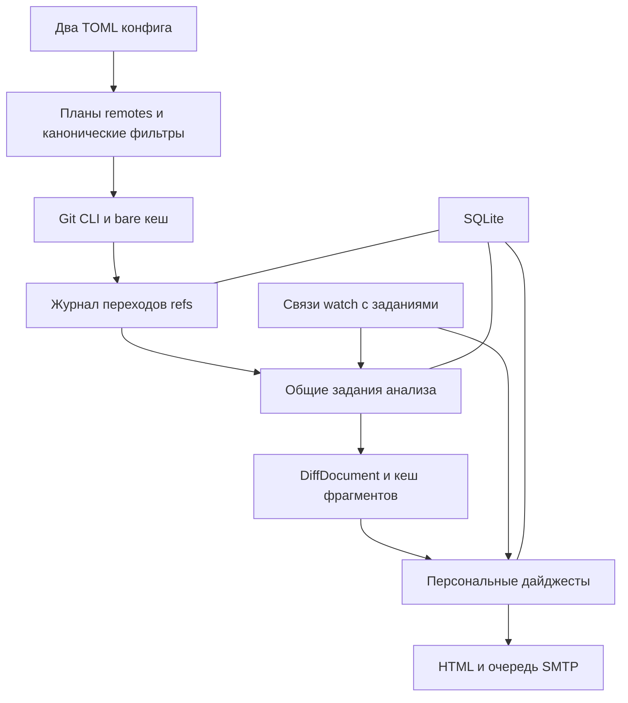
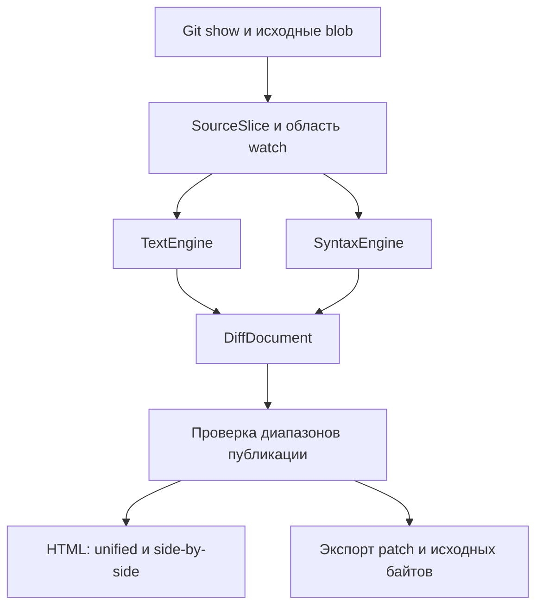

# Git Monitor — архитектура standalone-приложения на Rust

Git Monitor — standalone-приложение на Rust для наблюдения за несколькими репозиториями, remotes и ветками. Оно получает изменения общим Git-кешем, выбирает интересующие файлы или функции и отправляет каждому получателю свой дайджест с автономным HTML-вложением.

Решения версии 0.3 от 21 октября 2026 года: Rust, системный Git, собственные текстовый и структурный движки diff с общим HTML-рендерером, SQLite, два TOML-конфига и независимое состояние каждого remote. Конфигурация фиксируется на весь запуск; остановка выполняется через graceful shutdown. История обходится списком коммитов с git show для каждого; функция задаётся путём и выражением в семантике Git -L. Одинаковые вычисления объединяются; восстановление, лимиты ресурсов, тесты и бенчмарки входят в первый рабочий срез.

## Основные решения

| Область | Решение |
| --- | --- |
| Исполнение | Бинарник git-monitor и системный Git; diff и HTML принадлежат приложению |
| Репозитории | Управляемые bare-репозитории в настраиваемом каталоге |
| Несколько remotes | Один логический репозиторий содержит origin, upstream и другие источники |
| Состояние ветки | Отдельно для repository, remote, поколения источника и полного refname |
| Получение | Общий fetch для всех подписок на конкретный remote |
| Фильтры | Все выбранные ветки, конкретные ветки или маски; пути либо функция в файле |
| События | Коммиты, создание ветки, удаление ветки, переписывание истории |
| Уведомления | Персональные пакеты изменений сразу по нескольким репозиториям |
| Diff | TextEngine с возможностями просмотра уровня delta и SyntaxEngine на Tree-sitter; единый DiffDocument |
| Отчёт | Краткое письмо и автономный HTML со встроенными CSS, JS и данными |
| Переиспользование | Канонические фильтры, общие задания анализа и кеш рендера |
| Проверки | Тесты и benchmark harness с первого коммита; baseline до оптимизаций |
| Восстановление | Незавершённые fetch attempts восстанавливаются до нового fetch; задания и доставка имеют отдельные повторы |
| Жизненный цикл | FrozenConfig на запуск, остановка по SIGTERM/SIGINT, сохранение незавершённых работ |

Каталог репозиториев принадлежит приложению. Работа с пользовательскими рабочими копиями, HTTP-сервис, UI управления и поиск перемещения функций между файлами находятся за пределами первой версии. Изменения конфигурации выполняет оператор; получатели могут иметь разные наборы подписок.

## Репозитории remotes и ветки

Логический репозиторий объединяет связанные Git-источники, например собственный fork и upstream. У него одна база объектов: одинаковые объекты нескольких remotes физически переиспользуются. Все remotes внутри такого репозитория должны использовать одинаковый формат object ID; несовместимый источник размещается в другом логическом репозитории.

Идентификатор repository и идентификатор remote стабильны и задаются ключами конфигурации. Имена origin и upstream имеют обычное значение идентификаторов: специальных прав или приоритета у origin нет.

| Сущность | Пример |
| --- | --- |
| Логический репозиторий | llvm |
| Remote | origin или upstream |
| Ветка в источнике | refs/heads/main |
| Локальный ref | refs/remotes/origin/main |
| Другой локальный ref | refs/remotes/upstream/main |
| Ключ наблюдения | llvm, origin, source_epoch, refs/heads/main |

Одинаковые SHA в origin/main и upstream/main допускают общий кеш анализа. Появление коммита в каждом из этих refs остаётся самостоятельным событием. В отчёте рядом с веткой всегда указан remote.

Source epoch меняется при замене URL или контекста доступа источника. Новый источник получает начальный снимок; история старого не превращается в массовое удаление веток. Исключение remote или ветки из конфига означает прекращение наблюдения. Переименование идентификатора в первой версии трактуется как отключение старого и добавление нового источника.

## Конфигурация и расположение данных

Приложение читает ровно два пользовательских файла: monitor.toml и mail.toml. Первый содержит каталог хранения, источники, получателей и фильтры. Второй содержит SMTP и данные отправителя. Оба файла читаются и проверяются один раз при запуске; после разрешения переменных окружения формируется неизменяемый FrozenConfig. Во время работы файлы повторно не читаются. Изменение настроек применяется через graceful shutdown и новый запуск; SIGHUP логируется и игнорируется, reload отсутствует. Для run --once каждый вызов является новым запуском.

Все относительные пути разрешаются относительно каталога monitor.toml, независимо от текущего рабочего каталога процесса. Путь к mail.toml передаётся отдельным параметром CLI. Repository ID и remote ID ограничены строчными латинскими буквами, цифрами, дефисом и подчёркиванием; идентификатор не может содержать компоненты пути.

```toml
version = 1

[storage]
repositories_dir = "/var/lib/git-monitor/repos"
state_dir = "/var/lib/git-monitor/state"

[execution]
max_fetches = 4
max_fetches_per_host = 2
max_analyses = 4
git_timeout = "3m"
bootstrap_timeout = "30m"
shutdown_grace = "60s"

[defaults]
poll_every = "5m"
digest_every = "1h"
new_branch_mode = "summary"
max_message_bytes = 15000000

[diff]
mode = "auto" # text, syntax, auto
layouts = ["unified", "side-by-side"]
theme = "light"
line_numbers = true
moved_lines = true
line_algorithm = "histogram"
context_lines = 3

[limits]
max_blob_bytes = 32000000
max_patch_bytes = 64000000
max_job_output_bytes = 128000000
max_worker_address_space_bytes = 1073741824
analysis_timeout = "30s"
syntax_timeout = "5s"
max_syntax_nodes = 500000
max_syntax_candidates = 1000000
max_alignment_cells = 1000000
max_part_count = 100

[recipients.maxim]
to = ["maxim@example.org"]

[recipients.team]
to = ["team@example.org"]
digest_every = "24h"

[repositories.llvm]
[repositories.llvm.remotes.origin]
url = "ssh://git@git.example.org/toolchain/llvm-project.git"
poll_every = "5m"

[repositories.llvm.remotes.upstream]
url = "https://github.com/llvm/llvm-project.git"
poll_every = "15m"

[[watches]]
id = "asan-updates"
repository = "llvm"
remotes = ["origin", "upstream"]
recipients = ["maxim"]
branches = { include = ["main", "release/*"] }
paths = ["compiler-rt/lib/asan/**"]
events = ["commits", "branch_created", "branch_deleted", "history_rewritten"]

[[watches]]
id = "thread-start"
repository = "llvm"
remotes = ["upstream"]
recipients = ["maxim"]
branches = { include = ["main"] }
function = { path = "compiler-rt/lib/asan/asan_thread.cpp", match = 'ThreadStart' }
events = ["commits", "branch_created", "branch_deleted", "history_rewritten"]

[[watches]]
id = "libcxx-all-branches"
repository = "llvm"
remotes = ["upstream"]
recipients = ["team"]
branches = { all = true }
paths = ["libcxx/**", "libcxxabi/**"]
exclude_paths = ["**/test/**"]
events = ["commits", "branch_created", "branch_deleted", "history_rewritten"]
```

Ветка выбирается либо all = true, либо include с необязательным exclude. Эти варианты взаимоисключающие. Для масок веток и путей символ * не пересекает /, а ** пересекает; все ветки включаются через all = true. Пути считаются от корня дерева Git и чувствительны к регистру.

Один watch задаёт либо paths с необязательными exclude_paths, либо function с одним точным путём и выражением Git. Отсутствие обоих означает наблюдение за всем содержимым выбранных веток. Между repository, remotes, branches и содержимым действует AND; несколько watch объединяются через OR. Несколько совпавших watch становятся причинами включения одного изменения в дайджест.

Для branch_created и branch_deleted применяются фильтры repository, remote и ветки. Фильтр содержимого их не подавляет. History_rewritten всегда отображается для выбранной ветки, а diff ограничивается выбранным содержимым. На первой синхронизации существующие ветки образуют начальный снимок. Новые watch и добавленные области фильтров получают начальную точку; обратный просмотр истории выполняется отдельной операцией.

При изменении существующего watch непрерывно наблюдавшаяся и по-прежнему разрешённая область сохраняет очередь и прогресс. Добавленная область получает собственную начальную точку при первом подтверждённом наблюдении; она не сбрасывает прогресс прежней области. Изменение адресов, периода дайджеста или оформления не меняет версию селектора.

New_branch_mode = summary означает карточку новой ветки с SHA и начало наблюдения. Дополнительный режим compare требует явного base_remote и base_branch; отчёт называет эту базу. Это сравнение с выбранной базой, а не утверждение о том, откуда ветка была создана.

```toml
version = 1

[smtp]
host = "smtp.example.org"
port = 587
security = "starttls"
username = "git-monitor@example.org"
password_env = "GIT_MONITOR_SMTP_PASSWORD"
from = "Git Monitor <git-monitor@example.org>"
timeout = "30s"
```

В mail.toml разрешён password вместо password_env; одновременно указывать их нельзя. Файл с секретом доступен только владельцу. Git использует штатные SSH-настройки и credential helpers. Адреса и URL примера не являются действующей конфигурацией.

| Путь | Содержимое |
| --- | --- |
| repositories_dir/llvm.git | Bare-репозиторий со всеми remotes llvm |
| state_dir/state.sqlite3 | Наблюдения, задания, совпадения, дайджесты и доставка |
| state_dir/artifacts/ | Подготовленные HTML и полные MIME-письма |
| state_dir/tmp/ | Временные данные анализа |
| state_dir/instance.lock | Защита от двух одновременно работающих экземпляров |

Проверка конфигурации обнаруживает неизвестные remotes и recipients, повторяющиеся watch ID, неверные маски, конфликтующие селекторы и несовместимые параметры. Валидация функции против конкретного исходника выполняется отдельно от синтаксической проверки конфига. Каталоги создаются при запуске; смена repositories_dir не запускает автоматическое перемещение или удаление существующих данных.

## Компоненты приложения



| Модуль Rust | Ответственность |
| --- | --- |
| config | Однократное чтение двух файлов, FrozenConfig, версии селекторов и настроек доставки |
| lifecycle | Сигналы, остановка приёма работ, deadline shutdown и восстановление перед новым запуском |
| domain | Идентификаторы, OID, ключи refs, виды событий и состояния заданий |
| scheduler | Интервалы remote, backoff, ограничения по хостам и срок дайджестов |
| git | Git CLI, управляемые bare-репозитории, refs, граф коммитов, diff и удержание объектов |
| collector | Снимки remotes, определение переходов и запись событий |
| planner | Канонические фильтры, объединение одинаковых запросов и связи с watch |
| analysis | Общий анализ коммитов, путей и функций; получение ограниченных исходных диапазонов |
| diff | TextEngine, SyntaxEngine, сопоставление строк и токенов, перемещения и версионированный DiffDocument |
| store | Транзакции SQLite, задания, прогресс, миграции и попытки |
| digest | Границы выпусков, получатели и объединение совпадений |
| render | Собственный HTML/CSS/JS, unified и side-by-side из общей модели, пагинация и безопасное копирование |
| mail | MIME, SMTP, повторные попытки и учёт результатов |
| cli | Запуск, проверка конфигурации, диагностика и локальный просмотр |

Один Cargo package содержит бинарник и библиотеку с внутренними модулями. Дополнительные crates появляются при реальной потребности переиспользования. Domain не зависит от SMTP, SQLite или исполнения процессов; оркестрация вызывает конкретные адаптеры через небольшие контракты.

Основные контракты: GitBackend возвращает RemoteObservation, CommitDelta и содержимое по OID; Collector превращает наблюдение в RefEvent; QueryPlanner связывает watch с общими AnalysisRequest; ChangeAnalyzer возвращает SharedAnalysisResult и разрешённые исходные диапазоны; DiffEngine возвращает DiffDocument с координатами и типизированными аннотациями; ScopeProjector отсекает всё за пределами watch; Fanout связывает результат с каждым подходящим watch; DigestBuilder создаёт зафиксированный выпуск; Renderer создаёт HTML и части отчёта; MailTransport возвращает результат SMTP-попытки. Типы наблюдения включают область покрытых refs и source epoch, чтобы сужение конфигурации не выглядело удалением ветки. Движки diff не возвращают HTML или ANSI, renderer не обращается к Git.

Практический набор зависимостей: clap для CLI, serde и toml для конфигов, Tokio для процессов, сигналов и таймеров, rusqlite для SQLite, lettre для MIME и SMTP, Askama для HTML, globset для масок и tracing для журналов. Для сравнения выделенных последовательностей используется similar с byte-aware API и deadline; для разбора и подсветки — tree-sitter и tree-sitter-highlight с закреплёнными грамматиками. Собственный SyntaxEngine сопоставляет синтаксические деревья; подключать внутренние Rust API difftastic или разбирать его терминальный вывод не требуется. Delta и difft допускаются только как внешние средства сравнения качества при разработке, установка пользователем не нужна. Dev-dependencies включают Criterion и proptest. Версии и MSRV фиксируются при реализации; Cargo.lock включается в репозиторий. Функциональное выражение передаётся Git и не переписывается под регулярные выражения Rust. Git запускается списком аргументов без shell; refs читаются в машинном формате, а списки путей — с NUL-разделителями. Человеческий stderr не является протоколом получения событий.

SQLite обслуживает один выделенный worker. Синхронные запросы rusqlite и длительная генерация отчёта не блокируют async executor. Тяжёлые анализы выполняются ограниченным числом изолированных worker-процессов самого git-monitor; результаты передаются через проверяемые артефакты, а управляющий канал имеет ограниченный размер. Tokio управляет Git и worker-процессами; тайм-аут завершает группу дочерних процессов и дожидается их выхода, обработчики stdout и stderr исключают блокировку заполненных pipe. Ограничения действуют на построение patch, анализ, рендер и упаковку, а не только на готовое письмо. На Unix max_worker_address_space_bytes ограничивает адресное пространство через RLIMIT_AS; это не метрика RSS. Для других платформ нужен эквивалентный механизм; неподдерживаемый обязательный hard limit обнаруживается doctor до запуска работ.

## Получение изменений из нескольких remotes

Планировщик строит отдельный FetchPlan для каждого remote из объединения активных watch. Частота получения не зависит от частоты писем. Обновления разных логических репозиториев выполняются параллельно; изменяющие Git операции внутри одного bare-репозитория сериализуются. Это правило распространяется на fetch, служебные refs и maintenance.

Отдельный fetch вызывается для каждого remote. Успешный origin не откатывается из-за сбоя upstream. У каждого источника свои last_attempt_at, last_success_at, next_poll_at и статус ошибки. Атомарность Git refs одного fetch не распространяется на SQLite или остальные remotes.

Для наблюдения за всеми ветками используется полный refspec источника:

```bash
git -C /var/lib/git-monitor/repos/llvm.git fetch \
  --atomic --prune --no-prune-tags --no-tags --no-recurse-submodules \
  --no-auto-maintenance --no-write-fetch-head --porcelain \
  origin --refmap= '+refs/heads/*:refs/remotes/origin/*'
```

Для upstream используется собственное пространство refs/remotes/upstream/*. Служебные refs приложения находятся вне этих пространств и не попадают под prune remote. Автоматический prune тегов явно отключён, чтобы настройки Git не затронули общее пространство тегов.

При узком наборе веток Collector сначала получает успешный список видимых refs через ls-remote и сохраняет desired snapshot внутри FetchAttempt. Изменившиеся или недостающие объекты загружаются во временные refs этого attempt, без обновления опубликованных refs/remotes. Отсутствие ветки определяется по успешному discovery: точный fetch исчезнувшей ветки может завершиться ошибкой. Полученные OID сверяются с desired snapshot; при гонке и отсутствии нужного объекта выполняется новое discovery. Только после получения всех объектов одна транзакция update-ref --stdin публикует изменения и удаления с проверкой ожидаемых старых OID и служебный marker с хешем манифеста наблюдения. До этой публикации промежуточные download refs не считаются RemoteObservation. Пустой desired snapshot публикуется тем же способом.

Область сравнения включает только refs, покрытые текущим планом. Для расширенной области создаётся начальный снимок; для исключённой области наблюдение останавливается. Полная сверка всех локальных refs после узкого fetch не является доказательством состояния непроверенных веток.

Цикл для одного remote под блокировкой записи репозитория:

1. Завершить recovery всех незавершённых FetchAttempt этого репозитория до нового сетевого запроса, очистки refs, смены source epoch или maintenance. Восстановление использует сохранённый контекст attempt, даже если новый запуск прочитал другой конфиг.

2. Получить прежний снимок SQLite и сохранить FetchAttempt: ID, source epoch, исходный номер снимка, точный FetchPlan, область покрытия, namespace refs и необходимые версии правил. Удержать старые OID служебными refs до изменяющих операций. Фаза fetching фиксируется перед fetch; подготовка pins повторяема.

3. Выполнить atomic fetch для полного плана либо discovery, download и атомарную публикацию для узкого плана. Новые OID остаются достижимыми через опубликованные или временные refs до завершения фиксации. Запись результата попытки не требует повторного fetch.

4. Сформировать RemoteObservation из refs и манифеста attempt, сопоставить со старым снимком в той же области и определить события. Необработанный локальный результат нельзя перезаписывать следующим fetch.

5. Одной транзакцией SQLite сохранить события, задания, новый снимок и завершение FetchAttempt. Запись идемпотентна по attempt ID и исходной версии снимка; одинаковая пара old/new в другом attempt остаётся самостоятельным переходом.

6. После фиксации передать задания на независимую обработку, убрать ненужные временные refs и освободить блокировку. Pins активных заданий остаются.

В полном режиме опубликованные refs изменяет только один atomic fetch внутри известного FetchAttempt. При прерывании процесса до записи результата recovery сначала читает эти refs: атомарно изменившееся состояние завершается как наблюдение с отметкой interrupted, неизменившееся не создаёт событий. Неоднозначный статус процесса сам по себе не доказывает отсутствие веток. В узком режиме recovery принимает только завершённую атомарную публикацию с marker; незавершённый download не становится удалением. Git capability tests проверяют атомарность обновлений и prune, включая удаление последней ветки; неподдерживаемая комбинация не запускается с ослабленной гарантией.

Вывод fetch --porcelain полезен для статуса и диагностики; устойчивое сравнение опирается на сохранённый attempt и снимок SQLite. Однозначно неуспешный fetch без изменения refs не продвигает снимок. Ошибка аутентификации или сети не создаёт branch_deleted. Служебные markers и манифесты не попадают под remote prune.

Обязательный сценарий: SQLite=A, fetch получил B, процесс упал до транзакции, remote уже вернулся к A. После запуска сначала фиксируется восстановленный A → B и только затем новый B → A. Это правило действует и при SIGKILL; graceful shutdown уменьшает число таких восстановлений, но не заменяет их.

## События веток и диапазоны коммитов

| Старое состояние | Новое состояние | Событие |
| --- | --- | --- |
| Нет ref | Есть OID | branch_created |
| OID A | Тот же OID A | Событие не создаётся |
| OID A | Потомок B | branch_updated |
| OID A | OID B без продолжения A | history_rewritten |
| Есть ref | Ref отсутствует в подтверждённой области | branch_deleted |

Обычный поток коммитов вычисляется отдельно для каждого перехода old_oid..new_oid. Сначала git rev-list --reverse --topo-order old_oid..new_oid выдаёт полный список новых достижимых commit OID. Ограничение --first-parent не применяется к этому обходу: коммиты влитой ветки также должны попасть в анализ. Несколько диапазонов разных веток не объединяются одним списком исключений. Один и тот же коммит может быть новым для одной ветки и уже известным другой.

Для каждого OID сначала читаются родители и машинный список изменённых путей; после фильтрации git show строит patch только выбранных файлов. Базовые вызовы без shell:

```bash
git rev-list --reverse --topo-order OLD..NEW
git show --format= --raw -z --no-abbrev --no-renames \
  --diff-merges=first-parent --no-ext-diff --no-textconv COMMIT
git --literal-pathspecs show --format= --patch --no-color --no-renames \
  --diff-merges=first-parent --no-ext-diff --no-textconv \
  --diff-algorithm=histogram --unified=3 COMMIT -- PATH
```

OLD, NEW и COMMIT заменяются проверенными OID; PATH передаётся отдельным буквальным аргументом. Вывод raw -z является источником путей, режимов и blob OID; текст patch не используется как единственный протокол имён файлов. Корневой коммит сравнивается с пустым деревом. --diff-merges=first-parent применяется к представлению каждого коммита, включая merge с любым числом родителей, и не исключает коммиты боковых веток из rev-list. Combined diff не является форматом входа первой версии. Правила Git diff и отсутствие внешних helpers фиксируются профилем приложения; скрытые пользовательские настройки не меняют формат протокола.

Для history_rewritten отчёт содержит diff old → new, список вошедших коммитов old..new и список выпавших new..old. Поэтому откат к предку виден даже при пустом old..new. Old OID удерживается до сохранения результатов анализа.

Создание ветки даёт карточку remote/branch с OID. Удаление даёт карточку с последним наблюдавшимся OID; оно не означает удаления всех файлов репозитория. Удаление и последующее создание одинакового ref в разных наблюдениях образуют два события. Физическое переименование ветки представляется как удаление и создание.

Для merge git show вызывается с явным --diff-merges=first-parent: изменение при разрешении конфликта должно быть видно, даже если его нет ни в одном обычном коммите. Вошедшие коммиты показываются вложенным списком. Суммарный diff old → new служит дополнительным представлением. История является DAG: промежуточные события относятся к конкретной паре parent/commit, а не выдаются за единственную хронологию состояния ветки. Один patch влитого коммита и похожий patch merge сохраняют разные причины; дедупликация не стирает происхождение. Одинаковые commit OID в одном выпуске группируются с указанием всех подходящих remote и веток, но связь с каждым ref сохраняется.

Polling фиксирует наблюдавшиеся состояния и доступную историю. Создание и удаление ветки между проверками, а также недоступные промежуточные force-push могут остаться незамеченными. Время наблюдения не выдаётся за время push.

## Фильтры файлов и функций

Анализатор обходит список rev-list и для каждого коммита получает CommitDelta через git show. Дешёвый raw-список изменённых путей переиспользуется всеми watch; patch и blob читаются только после отбора. Файл подходит по старому или новому пути; переход из наблюдаемой области отображается как удаление из неё. Переименования без эвристического поиска представлены delete/add. Submodules показываются как изменения gitlink, Git LFS — как изменения pointer-файла; рекурсивная загрузка отключена.

Селектор функции — точный путь и выражение func из git log -L :func:path. Выбирается первое совпадение по правилам Git; номера строк и квалифицированные имена не становятся постоянной идентичностью. После переименования, при котором выражение перестаёт совпадать, регистрируется исчезновение. Поиск новой функции или другого файла не выполняется. Семантика выбора диапазона остаётся Git -L; обход истории и построение commit patch выполняются отдельно.

FunctionRangeResolver для каждого нужного снимка возвращает SelectedRange с byte offsets, исходными номерами строк и отпечатком эффективных правил либо NoMatch/AnalysisError. Практический адаптер создаёт служебный root commit с деревом снимка и запускает git log -L на этом единственном коммите: добавленный диапазон задаёт точные границы. Служебный commit удерживается на время извлечения, не показывается в истории и не отправляется наружу. Содержимое диапазона берётся из исходного blob, а не восстанавливается из цветного вывода. NoMatch проверяется отдельно от недоступного blob, неверного выражения и сбоя Git; адаптер имеет capability tests и контролируемую locale. Неизвестный отказ не превращается в отсутствие функции.

Для каждого подходящего parent/commit извлекаются диапазоны обеих версий, включая merge относительно первого родителя; корневой коммит имеет пустую старую сторону. Git show определяет изменения коммита, затем для function watch сравниваются выбранные исходные диапазоны. Нельзя просто переслать содержащий функцию hunk: в нём может быть соседний код. Diff строится из разрешённых диапазонов, его координаты переводятся в координаты исходного файла. Перенос диапазона вниз без изменения его байтов не создаёт function_modified. Соседняя функция и контекст за границей диапазона не попадают в отчёт.

| Результат сравнения | Событие содержимого |
| --- | --- |
| Раньше не было совпадения, теперь есть | function_appeared |
| Совпадение есть в обеих версиях, байты выбранного диапазона изменились | function_modified |
| Раньше было совпадение, теперь нет | function_disappeared |
| Удалён файл | function_disappeared с причиной file_deleted |
| Исходник или необходимые объекты недоступны | analysis_failed |
| Диапазон не изменился | Совпадение для рассылки не создаётся |

При первой проверке отсутствие функции означает ожидание. Проверяется каждый новый подходящий коммит, поэтому удаление и восстановление внутри одного polling-окна не исчезают даже при пустом итоговом diff. Для history_rewritten дополнительно сравниваются выбранные диапазоны old и new, включая откат к предку с пустым списком вошедших коммитов. Коммиты без совпадений также продвигают прогресс.

Атрибуты читаются отдельно для каждой стороны из её дерева через GIT_ATTR_SOURCE или --attr-source. Учитываются все .gitattributes на пути к файлу и определения разрешённых diff drivers. Штатные built-in драйверы и явно разрешённые текстовые xfuncname поддерживаются; внешние diff helpers и textconv отключены. Конфигурация разрешённых драйверов и унаследованных атрибутов фиксируется на запуск, входит в fingerprint; неподконтрольное глобальное переопределение не допускается для анализа. Настройки доступа SSH и credential helpers при этом сохраняются.

Изменение .gitattributes — редкий, но отдельный вход анализа. Raw-список проверяется на такие пути; для watch под изменившейся областью вычисляются эффективные fingerprints старой и новой стороны даже при неизменном blob исходника. Изменение fingerprint запускает повторное извлечение диапазона и создаёт analysis_rules_changed с обеими версиями правил. Изменившийся только из-за правил диапазон не выдаётся за редактирование исходника; при одновременной правке кода показываются обе причины. В ключ кеша входят оба fingerprints. Достаточно переоценивать активные function watch под затронутой областью; постоянный повторный анализ всех файлов не нужен.

Критерий уведомления — изменение выбранного исходного диапазона либо отдельное изменение условий анализа. Влияние макросов, заголовков и вызываемых функций не вычисляется.

## Качество diff и движки представления

Приложение владеет моделью diff и HTML-рендерером. TextEngine обеспечивает линейное сравнение с возможностями просмотра уровня delta; SyntaxEngine даёт структурное сравнение в духе difftastic. Delta и difft не являются runtime-зависимостями или форматом обмена. Их возможности используются как ориентир качества, а точное совпадение расположения строк или цветов с конкретной версией не является контрактом. Структурное сравнение понимает синтаксис; эквивалентность поведения программ не доказывается.

### Общая модель diff

GitAdapter возвращает CommitDelta: исходные пути и режимы, blob OID, родителей, patch и список изменений. ScopeProjector выдаёт разрешённые SourceSlice с исходными координатами. TextEngine и SyntaxEngine создают типизированный DiffDocument, который не содержит ANSI, HTML или терминальных ширин. HtmlRenderer работает только с этой моделью и разрешёнными исходными байтами. Повторный scope projection после структурного сопоставления обязателен до сохранения публикуемого результата.



| Тип | Данные и инварианты |
| --- | --- |
| SourceSlice | Blob OID, исходный путь, режим, byte range, начало в исходном файле, bytes и encoding status |
| FileDelta | Старый и новый пути, режимы, тип изменения, отсутствие стороны для add/delete |
| TextEdit | Equal/Delete/Insert/Replace, непересекающиеся byte ranges обеих сторон, связь с каноническим patch |
| LinePair | Старый и новый номера строк или отсутствие стороны; сопоставление для side-by-side |
| Span | Byte range, SyntaxKind, ChangeKind и необязательный MoveId; независимые слои аннотаций |
| SyntaxMatch | Соответствие узлов/токенов, тип и уверенность; без вычисления семантики программы |
| Hunk | Диапазоны обеих сторон, разрешённый контекст, edits, line pairs и продолжения |
| DiffDocument | Версия схемы, engine/profile, источники, text edits, опциональные syntax matches, hunks и quality/fallback metadata |

Byte offsets являются основной системой координат; LineIndex переводит их в исходные строки. Границы UTF-8 и отображаемые grapheme clusters учитываются отдельно. Конец файла без newline, CRLF, табуляции и невалидный UTF-8 не нормализуются молча. TextEdit и сохранённые байты должны позволять восстановить разрешённую новую сторону из старой; структурные аннотации не заменяют этот инвариант. Для function watch восстанавливается выбранный фрагмент, экспорт помечен как scoped diff и не выдаётся за применимый patch всего файла.

### TextEngine

Канонические изменения файла поступают из Git show с фиксированным histogram-профилем. Для изолированных SourceSlice, в том числе диапазонов функций, адаптер строит эквивалентный Git diff между разрешёнными снимками с тем же профилем и переносом координат. Полный patch function watch не публикуется. Внутристочное сопоставление и выравнивание используют библиотеку similar с deadline и byte-aware последовательностями; управление видом принадлежит приложению.

Сначала выделяются блоки добавлений и удалений. Строки внутри ограниченного блока сопоставляются по сходству токенов; max_alignment_cells ограничивает матрицу, не похожие строки остаются отдельными delete/insert. После сопоставления token diff и при необходимости grapheme diff формируют внутристочные spans. Достижение бюджета отключает только уточнение выравнивания с явной отметкой; канонические edits, исходные байты и координаты сохраняются. Изменение пробелов и комментариев остаётся доступным в текстовом виде.

Перемещения определяются по хешам удалённых и добавленных блоков с обязательной проверкой байтов и детерминированным выбором при повторениях. Поиск ограничен выбранными фрагментами текущего сравнения; межфайловые перемещения разрешены только внутри опубликованной области watch. MoveId является аннотацией delete/insert и не скрывает изменение. Исчерпывающий поиск копий по репозиторию не выполняется.

Подсветка синтаксиса независима от line diff. Tree-sitter-highlight выдаёт классы синтаксических токенов, палитра выбирается renderer. Полный файл может использоваться локально для лексического контекста, но до упаковки spans и bytes обрезаются по SourceSlice. Для неподдерживаемого языка остаются полноценные текстовый diff и внутристочная подсветка с отметкой syntax_highlighting_unavailable. Нельзя заявлять поддержку языка только по расширению: она проверяется корпусом.

### SyntaxEngine

Вход — старый и новый исходники с деревьями Tree-sitter и выбранными диапазонами. Первоначальный проверяемый набор грамматик: C, C++, Rust, Python и JSON; версии, ABI и highlight queries закреплены в сборке. Добавление языка требует fixtures, проверки координат и бюджета. C++ анализируется синтаксически без compile_commands и раскрытия препроцессора; ошибки разбора в области сравнения ведут к текстовому fallback.

Алгоритм последовательно выделяет одинаковые поддеревья по типу и хешу с проверкой содержимого, сопоставляет оставшиеся узлы по родителям и устойчивым якорям, затем сравнивает листья и разделители внутри ограниченных областей. Повторяющиеся поддеревья разрешаются детерминированно. Бюджеты ограничивают число узлов, кандидатов сопоставления, размер исходников и время. Это собственный алгоритм с версионированным контрактом; полный паритет эвристик difftastic заранее не обещается.

SyntaxMatch проецируется в исходные byte ranges и LinePair. Форматирование может не иметь структурных различий; в таком случае сохраняется уведомление и текстовый вид с пометкой text_only_change. Комментарии учитываются отдельно от значимых узлов и не теряются. Перемещение может отображаться как связь узлов, но текстовый слой остаётся полным.

Для function watch деревья могут строиться по полным файлам для контекста. В HTML, JSON, поисковый индекс и экспорт попадают только диапазоны выбранной функции. Если соответствия нельзя надёжно спроецировать без соседнего кода, используется TextEngine с причиной scope_projection_failed. AST не меняет правила Git -L и не начинает отслеживать перемещение функции в другой файл.

Режим text использует TextEngine; syntax запрашивает структурный вид с обязательным явным fallback; auto выбирает структурный вид при поддержанном языке, надёжном разборе и достаточном бюджете. Причины fallback различаются: unsupported_language, parse_error, syntax_budget_exceeded, scope_projection_failed, engine_error. Текстовый вид доступен также при успешном структурном сравнении. Превышение общего лимита исходника или общего анализа является oversized_item/analysis_failed, а не успешным пустым diff.

### Собственный HTML-рендерер

| Возможность | Контракт |
| --- | --- |
| Подсветка синтаксиса и внутри строки | Независимые spans синтаксиса и изменений, CSS-темы и легенда |
| Unified и side-by-side | Одна модель edits/LinePair; переключение без запуска Git или сравнения |
| Структурный и текстовый виды | Переключение аннотаций одного изменения с явным engine/quality |
| Номера строк | Координаты исходных файлов, включая scoped function diff и части |
| Длинные строки | CSS wrapping или горизонтальная прокрутка; отсутствие скрытой обрезки хвоста |
| Перемещения | Связанные MoveId и переходы между разрешёнными блоками |
| Темы и layout | Светлая/тёмная тема, адаптивная ширина; изменения CSS не требуют пересчёта diff |
| Навигация | Локальные якоря файлов, hunks, функций, событий и продолжений |
| Копирование и экспорт | Исходные байты отдельно от номеров, знаков diff и оформления |

HtmlRenderer генерирует автономный HTML/CSS/JS непосредственно из DiffDocument. Unified заранее читается без JS; интерактивный side-by-side и структурные аннотации используют ту же разрешённую модель. Если выбран только side-by-side, остаётся заранее отрисованное читаемое представление. Вложение не требует terminal-to-HTML преобразования. Изменение ширины окна управляет CSS и не входит в DiffKey; тема и layout относятся к RenderKey.

Код, пути, авторы и сообщения коммитов экранируются как данные. JSON внутри HTML безопасно кодируется, включая символ < и закрывающие script-последовательности; исходник не вставляется через innerHTML. Управляющие байты показываются как обозначения и не интерпретируются как ANSI. UTF-8 копируется как текст, для прочих данных предоставляется точный byte download с обозначением кодировки; обещание сохранности байтов проверяется по экспорту. Поиск и сворачивание не включают скрытые данные других watch. Большие документы разбиваются на ограниченные части до построения DOM.

Качество собственного движка проверяется матрицей возможностей и корпусом исходных пар. Delta и difft могут использоваться как dev-reference с записанными версиями; различие эвристик само по себе не ошибка. Блокирующие инварианты: полнота изменений, восстановление байтов, корректность координат, ограничения scope, отсутствие обрезки и читаемость без JS.

## Состояние и восстановление

| Хранилище | Назначение |
| --- | --- |
| repositories и remotes | Стабильные ID, каталог, object format, source epoch и расписание |
| fetch_attempts | Предыдущий снимок, frozen plan, scope/source epoch, фазы получения и recovery |
| ref_states | Последний подтверждённый OID каждого ref и версия состояния |
| ref_events | Неизменяемые события old → new и последовательность наблюдений |
| analysis_jobs | Общая работа по уникальному QueryKey с lease |
| watch_jobs | Связи event, watch и версии watch с общей работой |
| query_results и diff_results | Результаты анализа, DiffDocument и качество, включая пустые совпадения |
| config_revisions и watch_bindings | Несекретные снимки правил, версии селекторов, границы активации областей и привязки получателей |
| matches | Результаты фильтров, фрагменты diff и причины включения |
| digests и digest_items | Получатель, фиксированная граница выпуска и выбранные результаты |
| deliveries | MIME-части, Message-ID, состояние и попытки SMTP |
| object_pins | Служебные refs, удерживающие нужные старые объекты |

OID хранится как тип GitOid с известным форматом репозитория; длина SHA-1 не зашивается в бизнес-логику. Событие имеет собственный ID и порядковый номер. Пара old/new не является уникальным ключом: переход A → B может повториться.

Разделяются два прогресса. Снимок refs продвигается после сохранения событий и заданий. Прогресс watch продвигается после сохранения результата его анализа, включая отсутствие совпадений. Доставка имеет отдельное состояние и не управляет получением Git.

Analysis job уникальна по каноническому QueryKey. Связь watch_jobs уникальна по event ID, watch ID и версии watch; несколько связей могут ожидать один результат. Задание имеет running с lease, а просроченный lease после перезапуска возвращается в pending. Пустой результат сохраняется как успешный. Результаты и Match записываются идемпотентно; источник события и список потребителей не теряются при повторе. Отмена одного watch не отменяет общую работу, нужную остальным. На новом запуске привязки watch сверяются с FrozenConfig. Отозванная область не создаёт новых отправок; сохранённые результаты и задания по-прежнему разрешённой области не отбрасываются только из-за новой версии конфига. Неизменные селекторы и прежние области аддитивного расширения продолжают прогресс, добавленные области получают отдельную границу активации. Несовместимая замена селектора завершает прежнее наблюдение и создаёт новую границу; отмена конкретных привязок сохраняется в журнале. Ошибки сохраняются отдельно и повторяются по политике retry, без превращения в пустой результат.

| Момент сбоя | Поведение после перезапуска |
| --- | --- |
| После fetch до записи события | Завершить сохранённый FetchAttempt из локального результата до любого следующего fetch |
| После записи события до анализа | Продолжить сохранённые analysis jobs |
| После анализа до дайджеста | Включить сохранённые matches в очередной выпуск с проверкой FrozenConfig нового запуска |
| Во время shutdown или после SIGKILL | Возобновить pending и восстановить просроченные leases; сначала recovery Git attempts |
| После создания HTML до фиксации выпуска | Удалить или переиспользовать не привязанный временный артефакт |
| После фиксации выпуска до SMTP | Отправить сохранённое MIME-письмо |
| После приёма SMTP до записи sent | Повтор возможен; используется прежний Message-ID |

Атомарной транзакции между Git, файловой системой и SQLite нет. FetchAttempt, pins и обязательный recovery до следующего fetch закрывают окно Git → SQLite. Артефакты сначала записываются во временный файл, синхронизируются, атомарно переименовываются с синхронизацией каталога и связываются с записью БД; политика durability SQLite соответствует этому контракту. Непривязанные файлы убираются maintenance после recovery. Результат worker принимается только с актуальным lease/attempt token, поэтому завершившаяся старая попытка не перезаписывает новый результат.

SMTP обеспечивает повторяемые попытки доставки, но не универсальное exactly once. При неоднозначном результате соединения возможен дубликат. Постоянный Message-ID помогает идентифицировать выпуск, однако не гарантирует дедупликацию почтовым сервером.

## Конфигурация на запуск и graceful shutdown

При запуске приложение захватывает instance.lock, один раз читает оба конфига, проверяет capabilities и строит FrozenConfig. После этого восстанавливает незавершённые FetchAttempt в их сохранённом контексте, сверяет очереди с новой конфигурацией и лишь затем разрешает scheduler, SMTP и maintenance. В config_revisions сохраняется только необходимая несекретная версия правил; пароли и значения credential helpers в SQLite не записываются. Уже полученные результаты остаются данными аудита независимо от последующей отмены рассылки.

Во время работы модификация TOML или окружения не меняет подписки, адреса и SMTP-параметры. Ни планировщик, ни отправитель не перечитывают файлы перед работой. Оператор применяет изменения командой остановки и новым запуском. При новом запуске изменение только адреса или периода пересобирает pending delivery и не сбрасывает анализ. Для аддитивного расширения watch сохранённые задания и matches прежней области сохраняются; для сужения конкретные элементы повторно проецируются в новую разрешённую область, отозванные элементы отменяются с причиной. Если безопасную проекцию доказать нельзя, элемент не отправляется и отмечается как revoked_scope, а не как успешное отсутствие изменений. Подготовленное MIME при изменении содержимого или адреса получает новую delivery revision; неоднозначные старые попытки остаются в аудите.

| Фаза | Поведение |
| --- | --- |
| Running | Scheduler принимает работы; используется один FrozenConfig |
| Quiescing | Первый SIGTERM/SIGINT запрещает новые fetch, leases, выпуски и SMTP-попытки |
| Draining | Завершаются уже начатые операции в пределах shutdown_grace; результаты и состояния фиксируются |
| Stopped | Процессы reap, временные результаты учтены, SQLite worker завершён, lock освобождён |

Shutdown не пытается обработать всю сохранённую очередь и не отправляет досрочно суточный дайджест. Уже начатый fetch по возможности доводится до фиксации наблюдения. Активный анализ сохраняет готовый результат либо освобождает свою lease после остановки worker. Начатая SMTP-попытка получает ограниченное время на завершение; при разрыве после возможного приёма сервером фиксируется uncertain, повтор использует прежний Message-ID, если адрес и MIME не изменились. Доступ к SQLite сохраняется до завершения этих фиксаций.

По истечении shutdown_grace либо при повторном сигнале дочерние группы завершаются и reap; незавершённые FetchAttempt и pending jobs сохраняются для recovery. SIGKILL и потеря питания обрабатываются тем же протоколом следующего запуска. Для run --once нормальное окончание прохода также дожидается начатых операций. systemd TimeoutStopSec должен превышать shutdown_grace с запасом на остановку процессов и финальные записи. Новые настройки применяются только после завершения старого экземпляра; изменение файла само по себе не является отзывом доступа у работающего FrozenConfig.

Instance lock защищает state_dir; дополнительно блокировка/ownership marker каждого управляемого bare-репозитория запрещает двум независимым state_dir одновременно использовать один repositories_dir. Все изменяющие Git операции и recovery подчиняются этой блокировке.

## Персональные дайджесты и HTML

Выпуск принадлежит одному recipient ID и содержит изменения всех его watch по нескольким репозиториям и remotes. Срок отправки определяется digest_every получателя. Значение 0s собирает всё готовое в один выпуск в конце текущего прохода. Выпуск фиксирует cutoff событий и включённые Match ID; более поздние события переходят в следующий выпуск.

Дайджест захватывает завершённые задания до cutoff. Ошибочные задания получают собственные записи об ошибке; поздние результаты повторного анализа попадают в следующий выпуск с исходным временем наблюдения. Включение определяется ещё не опубликованными Match ID, поэтому старый номер события не исключает поздний результат. Пропуски обработки не превращаются в утверждение об отсутствии изменений.

Письмо содержит text/plain и простой text/html со сводкой; автономный отчёт прикладывается отдельным text/html attachment. Вложение включает CSS, небольшой JS и все необходимые данные. Оно не обращается к HTTP-сервису, CDN или внешним шрифтам. Для function watch включается только выбранный диапазон и его diff.

В отчёте доступны навигация repository → remote → branch → file, собственная синтаксическая и внутристочная подсветка, текстовый и структурный виды, unified и side-by-side, номера строк, перенос длинных строк без обрезки, поиск, сворачивание и фильтры событий. Суммарный diff и история переключаются отдельно. Создание и удаление веток заметны отдельно от файловых изменений. Каждый фрагмент показывает engine, версию модели, качество/fallback, совпавшие watch и источники.

Базовое содержимое заранее отрисовано и читается при отключённом JS. Интерактивность рассчитана на открытие сохранённого вложения в браузере; встроенный почтовый предпросмотр может её ограничить. Содержимое кода, пути и сообщения коммитов экранируются как данные. Переключатели интерфейса не скрывают недоступные получателю данные: такие данные не включаются в файл.

Max_message_bytes ограничивает точные сериализованные MIME-байты с учётом кодирования и заголовков. Размер проверяется потоково до фиксации deliveries. Выпуск делится на самостоятельные нумерованные части с общим cutoff и manifest. Сначала границы проходят между файлами и hunks, затем при необходимости внутри одного hunk. Каждая часть содержит заголовок файла, исходные координаты, номера продолжений, минимальный контекст в разрешённой области и собственные CSS/JS. Изменённая строка или большой function range не считаются неделимыми.

Строка, которая сама не помещается, делится на byte ranges с границами UTF-8 там, где он валиден; фрагмент показывает исходный номер строки и диапазон байтов. Экспорт каждого фрагмента сохраняет точные байты, manifest задаёт порядок сборки и хеш полного разрешённого содержимого. Нельзя бесконечно пытаться упаковать тот же неделимый item или молча обрезать хвост. Идентификаторы частей и Message-ID окончательно фиксируются после проверки размера; изменение упаковки создаёт новую delivery revision. Минимальный размер письма и max_part_count проверяются до создания очереди.

Отдельные лимиты ограничивают размер blob, patch, общий вывод задания, адресное пространство worker, время анализа, синтаксические узлы и матрицу выравнивания. Git/worker stdout пишется ограниченно и при необходимости spool на диск; превышение прекращает операцию и создаёт oversized_item с причиной и доступными размерами/OID. Если синтаксический бюджет исчерпан, допустим явный текстовый fallback в общем бюджете. Если превышен общий бюджет или max_part_count, результат не становится успешным пустым diff: получатель получает небольшую диагностическую карточку, полный уже созданный scoped artifact сохраняется локально, остальные изменения продолжают рассылаться. Для полного результата оператор повышает лимит и явно повторяет выбранное задание. Ошибки ресурсов не повторяются бесконечно с тем же лимитом.

Проверка размера выполняется после scope projection; полный файл другой области нельзя приложить вместо oversized function diff. Диагностические карточки, manifests и экспорт также содержат только разрешённые источники получателя. Двоичные объекты остаются метаданными, если их содержимое не запрошено отдельным контрактом.

Перед созданием и отправкой выпуска проверяются привязки к FrozenConfig данного запуска. Файлы конфигурации повторно не читаются. Пересборка pending-выпусков после изменения настроек происходит при следующем запуске до включения SMTP; применяются правила сохранения разрешённых matches и отзыва scope из раздела жизненного цикла. Выпуски хранят версии селектора, привязок получателя и доставки отдельно. Начальная точка новой области не отменяет неотправленные результаты прежней области; автоматический backfill нового интереса отсутствует.

Оператор процесса доверенный и имеет доступ ко всем локальным кешам. Область получателя задаётся watch и remotes в конфигурации. Фильтры пути и функции определяют интерес; разграничение доступа к частям исходного репозитория как отдельная система ACL в эту версию не входит.

## Дедупликация фильтров и вычислений

Дедупликация включается с первого рабочего среза. QueryPlanner канонизирует условия, объединяет одинаковые запросы и сохраняет связи с каждым watch. Fetch уже общий на remote; дополнительно общими становятся чтение графа, список путей, извлечение диапазонов, тяжёлое сравнение и HTML-фрагменты.

Из ключа вычисления исключаются адрес получателя, watch ID, подпись и период рассылки. Регистр и Unicode путей сохраняются, а выражение функции передаётся буквально. Канонизация сортирует и удаляет повторяющиеся элементы только там, где порядок не влияет на заявленную семантику множеств. Эквивалентность разных регулярных выражений не доказывается.

| Уровень | Ключ и условия переиспользования |
| --- | --- |
| Канонический фильтр | Версия схемы, области источников и веток, пути или функция, политика отбора |
| CommitKey | Repository/object format, commit и выбранный parent, профиль Git show, версия Git и правила атрибутов |
| QueryKey | Область кеша, old/new OID, селектор, правила обхода/родителей, версии анализатора/Git и fingerprints правил обеих сторон |
| ParseKey | Область кеша, blob OID, язык, версии Tree-sitter/грамматики и профиль разбора |
| DiffKey | Хеш входов и диапазонов, engine, версия DiffDocument, алгоритмы, грамматики и профиль бюджетов/fallback |
| RenderKey | Scoped DiffDocument, версия renderer, layout, тема, стиль и профиль разбиения; ширина окна не влияет на diff |

Raw-список изменённых путей читается один раз на CommitKey и используется всеми группами фильтров; одинаковый коммит в нескольких переходах не запускает повторный git show с теми же входами. Содержимое одного blob читается пакетно и кешируется. После отбора конкретного перехода фильтры с разными ветками могут переиспользовать расчёт, если их фактические входы совпадают. Разные old/new, атрибуты, политики обхода или области доступа дают разные QueryKey.

Для каждого QueryKey работает одна analysis job. In-flight объединение присоединяет одновременных потребителей к уже выполняющейся работе. Уникальный ключ SQLite и lease защищают от повторного старта после перезапуска. Успешный пустой результат кешируется; временная ошибка не становится вечным пустым результатом. Pins исходных объектов удерживаются до завершения всех зависимых общих работ.

Если 100 получателей следят за одной функцией в одном переходе, ожидается один тяжёлый анализ и один рендер на профиль отображения. Формирование персонального MIME и отправка выполняются для каждого получателя. Для разных тем или layout наборов добавляются свои RenderKey, сохраняя общий анализ. Персональные причины включения, имена watch и источники добавляются при упаковке поверх общего фрагмента и не загрязняют кеш другими привязками. Увеличение лимитов после oversized_item меняет профиль попытки; старый ресурсный отказ не блокирует явный повтор.

События refs и связи с watch остаются самостоятельными: один commit в origin/main и upstream/main может требовать двух уведомительных привязок. В рамках одного персонального выпуска одинаковый фрагмент объединяет причины включения. Каждый получатель проходит собственный отбор перед упаковкой; кеш фрагментов не означает общего файла с чужими источниками.

Первая версия объединяет точные канонические совпадения и общие низкоуровневые входы. Перекрывающиеся, но разные фильтры могут потребовать разных анализов. Это ограничивает сложность планировщика; пользу дальнейшего объединения показывают бенчмарки, а корректность проверяется сравнением с наивным исполнителем.

## Производительность и обслуживание

Fetch выполняется на remote, а не на подписчика. При отсутствии изменений выполняется только проверка refs. Содержимое скачивается инкрементально и переиспользуется всеми watch. Совпадающие пары версий и условия анализа используют общий результат; одинакового нового OID при разных исходных точках недостаточно для объединения обхода истории.

Для первоначальной загрузки применяется bootstrap_timeout, для инкрементальных операций — git_timeout. Для отдельных веток используется discovery и загрузка изменившихся refs; для всех веток — прямой fetch без обязательного предварительного запроса. Расписания содержат jitter, ошибки вызывают экспоненциальный backoff с верхней границей. Максимальная задержка обнаружения остаётся явной настройкой через poll_every. Отключённые источники не опрашиваются.

Основной режим хранит полные Git-объекты доступной истории выбранных refs, чтобы анализ оставался локальным. Shallow clone не является стандартным режимом. Blobless можно добавить после измерений начальной загрузки и нагрузки; несколько promisor remotes требуют отдельной проверки маршрутизации недостающих объектов.

Маски путей применяются до построения patch. Функции анализируются при изменении исходного пути либо эффективных правил его диапазона; атрибутные изменения дешёво проверяются отдельной веткой отбора. QueryPlanner объединяет одинаковые вычисления и использует кеши по неизменяемым входам. Blob размер проверяется через cat-file до загрузки; чтения выполняются пакетно и ограниченно. Собственное обнаружение moved blocks ограничено выбранным diff; исчерпывающий поиск переименований и копий по репозиторию не включается. Commit graph и repack обслуживаются отдельной задачей после recovery.

GC выполняется под блокировкой записи репозитория. Служебные refs удерживают активные исходные точки, незавершённые FetchAttempt и необработанные события; после сохранения необходимых фрагментов и завершения зависимых заданий pins освобождаются. Старые digest-артефакты и журналы очищаются по отдельной политике хранения; незавершённая доставка не удаляется автоматически.

Структурированные логи содержат repository, remote, event ID, watch и digest ID. Диагностика показывает последнюю успешную проверку каждого remote, длительность fetch, объём Git-кеша, очередь анализа, возраст pending-доставок и результат последней попытки. Секреты SMTP и URL с credentials редактируются в логах. Дополнительно измеряются общее и уникальное число фильтров, число общих AnalysisRequest, Git и diff-процессов, cache hit по этапам, wall time, CPU time, память и размер артефактов. Метод измерения ресурсов дочерних процессов записывается вместе с результатами.

## CLI и этапы реализации

| Команда | Назначение |
| --- | --- |
| git-monitor check-config | Проверить два файла и ссылки между сущностями без сети |
| git-monitor run --once | Один проход получения, анализа и отправки готовых выпусков |
| git-monitor run | Постоянный polling тем же движком |
| git-monitor status | Показать состояние источников и очередей |
| git-monitor preview --recipient ID | Локальный HTML из уже сохранённых результатов без отправки |
| git-monitor doctor | Проверить Git capabilities, доступность каталогов и целостность состояния |
| git-monitor retry-deliveries | Повторить готовые неуспешные отправки |
| git-monitor retry-analysis --job ID | Явно повторить анализ после изменения лимитов или устранения ошибки |

Пути конфигов передаются через --config и --mail-config. Одновременно работает один изменяющий состояние экземпляр на state_dir. Основной способ автоматического запуска — systemd timer или cron с run --once; постоянный процесс использует ту же логику и те же ограничения. Оба режима используют FrozenConfig и graceful shutdown; изменения TOML применяются следующим запуском. Doctor явно отделяет локальную проверку от запрошенной сетевой диагностики; SMTP-тест является отдельным явно вызванным действием.

1. Ввести domain, FrozenConfig из двух файлов, каталоги, lifecycle, GitBackend и fixtures. В тот же коммит добавить SIGTERM/SIGINT и ограниченный shutdown, тесты контрактов, Criterion harness, счётчики операций и микробенчмарки планировщика; численные результаты сохранять для реализованных сценариев.

2. Реализовать FetchPlan/FetchAttempt, несколько remotes, снимки, pins и recovery до следующего fetch. Добавить rev-list и git show по каждому commit, включая first-parent merge patch. Сразу проверить сбои A → B → A, пустой remote, узкую атомарную публикацию, no-op и стоимость bootstrap/инкрементального получения.

3. Добавить пути, FunctionRangeResolver, проверку атрибутных зависимостей, QueryPlanner и версионированные кеши. Ввести DiffDocument/TextEngine, лимиты и scoped export. Проверить merge conflict, удаление с восстановлением и изменение только .gitattributes. Сравнить общий и наивный исполнители на одинаковых fixtures.

4. Реализовать собственный HtmlRenderer: unified/side-by-side, syntax/intraline spans, moved blocks, копирование, автономный HTML и персональный MIME. Добавить разбиение одного большого hunk/строки и oversized_item. Зафиксировать end-to-end baseline-v0 текстового пути после выполнения матрицы качества, до последующих оптимизаций.

5. Завершить устойчивую SMTP-доставку, CLI, maintenance и интеграцию остановки со всеми очередями. Добавить SyntaxEngine: закреплённые Tree-sitter грамматики, matcher, проекцию и fallback. Готовность структурного режима оценивается отдельно от текстового baseline; он включается после тестов качества, бюджетов и отсутствия утечки соседнего кода. Каждый этап сопровождается тестами и сравнением с baseline.

Тесты и бенчмарки развиваются вместе с каждым этапом. Наивный исполнитель используется как проверяемая сравнительная реализация в tests и benches; производственный режим переиспользует общую работу. Для Git создаются детерминированные временные репозитории, а отправка проверяется локальным SMTP. Архитектурная спецификация не содержит вымышленных измерений: численный baseline появляется при запуске реализованного сценария.

## Тесты с первого коммита

Тесты проверяют наблюдаемое поведение и сохранность данных. Вместе с первым реализованным компонентом появляются соответствующие fixtures и тесты; интеграционные проверки добавляются по мере появления полного пути обработки.

| Группа | Проверяемые свойства |
| --- | --- |
| Unit и property tests | Канонизация не меняет семантику масок, разные селекторы не сливаются, перестановка множеств сохраняет результат |
| Интеграция с Git | Несколько remotes, rev-list/show, root и octopus merge, изменение при conflict resolution, pins, атомарный prune и recovery до fetch |
| Функции | Изменение и исчезновение, удаление/восстановление, перенос строк без изменения байтов, соседний hunk, атрибуты без правки исходника и C++ |
| Дедупликация | Наивное и общее выполнение дают одинаковые изменения и адресацию; N одинаковых запросов запускают одну работу |
| Конкурентность и сбои | Lease fencing, SIGTERM на каждом этапе, deadline и SIGKILL, recovery A → B → A, неизменность FrozenConfig, сохранение очереди при расширении watch |
| Diff и HTML | DiffDocument, восстановление байтов по edits, line pairing, syntax/intraline spans, moved blocks, Unicode/invalid UTF-8, отсутствие обрезки и чтение без JS |
| Scope и MIME | Только свои диапазоны во всех представлениях/JSON/export, точный размер MIME, разделение одного hunk и строки, max_part_count и oversized_item |
| SyntaxEngine | Матчинг поддеревьев/токенов/разделителей, повторы, комментарии, parse errors, бюджеты, text_only_change и function scope projection |

Property tests и дифференциальная проверка используют простой наивный исполнитель с теми же входами. Добавление ещё одного получателя не меняет содержимое отчёта прежнего. Добавление дублирующего watch добавляет причину включения, сохраняя один фрагмент. Изменение одного параметра, влияющего на результат, должно предотвращать неверное переиспользование.

Для собственного движка хранится корпус исходных пар, ожидаемых edits, координат и аннотаций. Property tests проверяют восстановление разрешённых байтов, корректность line/byte maps и инварианты scope. Результаты delta/difft допустимы как dev-reference с записанными версиями и объяснёнными отличиями; одинаковый ANSI или DOM с ними не требуется. Нормализованный собственный DOM дополняется визуальными snapshots. Browser-тесты открывают автономный файл с запрещённой сетью, проверяют виды, адаптивную ширину, темы, навигацию, поиск, byte export и чтение без JS. Fuzz targets покрывают raw/patch parser, DiffDocument, scope projection, HTML/JSON escaping и splitter; особенно проверяются HTML/script, управляющие байты и невалидный UTF-8.

Каждый PR запускает форматирование, lint, функциональные тесты и smoke-проверку benchmark targets. Ошибки корректности и детерминированных счётчиков блокируют изменение. Временные Git-репозитории и SMTP фикстуры локальны; реальные репозитории пользователей и реальные адресаты в тестах не используются.

## Бенчмарки и baseline

С первого коммита создаётся Criterion harness для реализованных модулей и общий формат результатов. Численный end-to-end baseline-v0 фиксируется на первом минимальном сквозном проходе fetch → rev-list/show → отбор → TextEngine → HTML → MIME, до последующих оптимизаций. Сценарий без дедупликации остаётся сравнительной реализацией только в tests и benches.

| Сценарий | Что измеряем |
| --- | --- |
| Начальная загрузка | Создание кеша, получение объектов и установка baseline refs |
| Polling без изменений | Стоимость проверки refs и отсутствие тяжёлого анализа |
| Один изменённый файл | Инкрементальные получение, отбор, diff и упаковка |
| Фильтр функции | Изменение функции, соседнее изменение и исчезновение |
| Много refs и remotes | Рост стоимости discovery, обновления и маршрутизации |
| Повторяющиеся фильтры | N = 1, 10, 100, 1000 потребителей при U = 1 уникальном запросе |
| Разные фильтры | U = N; накладные расходы планировщика без выигрыша от кеша |
| Разные диапазоны | Одинаковый селектор при разных old/new не объединяется ошибочно |
| Один blob в нескольких ветках | Переиспользование чтения и допустимого сравнения |
| Тяжёлый diff | Git patch, line pairing, intraline spans, moved blocks, Unicode и длинные строки |
| Структурный diff | Parse cache, matcher, узлы/кандидаты, scope projection и fallback |
| Лимиты | Время и память до oversized_item, bounded spool, один большой hunk/строка и max_part_count |
| Остановка и recovery | Задержка SIGTERM, состояние очередей и восстановление до следующего fetch |
| Большой дайджест | Рендер, MIME-кодирование и разделение на части |

Каждый сценарий выполняется с пустыми и прогретыми кешами приложения; состояние Git pack, commit graph и кеша ОС записывается отдельно. Пустой кеш приложения не называется холодным диском. Создание fixture находится вне измеряемого участка, кроме специального bootstrap-сценария. Git-транспорт локальный и контролируемый; поведение живого GitHub не участвует в baseline. Корпус исходников включает C/C++, Rust, Python и JSON. Коммиты, даты, тестовые часы, топология и seed генератора фиксированы.

Измерения охватывают wall time и CPU, память приложения и дочерних процессов, число Git/diff вызовов, чтения blob, cache hit, число исходных и уникальных фильтров, размер Git-получения и готового MIME. Размер передачи указывается только при измеряемом транспортном счётчике; размер локального pack не выдаётся за сетевой трафик. Для end-to-end сохраняются распределения полных прогонов и p50/p95; у микробенчмарков — оценки Criterion и их интервалы.

Детерминированный инвариант: при N одинаковых потребителях одного QueryKey число тяжёлых анализов равно одному; рендер выполняется один раз на RenderKey. Фан-аут, персональная упаковка и отправка закономерно растут с числом получателей. Ускорение по времени заранее не объявляется: отдельно показываются выигрыш вычислений и стоимость рассылки.

Baseline сохраняет commit приложения, rustc и target, профиль сборки, Cargo.lock, версии Git, TextEngine/SyntaxEngine/DiffDocument, Tree-sitter/грамматик и профили бюджетов, хеш fixture и конфига, CPU, ОС, память, файловую систему и параметры выборки. Сводка и manifest версионируются в benchmarks/baselines, сырые результаты и HTML-отчёт сохраняются как артефакты CI. Отчёт показывает baseline, текущий результат, изменение и разброс. Baseline не перезаписывается обычным сравнительным запуском.

```bash
cargo bench --bench baseline -- --save-baseline baseline-v0
cargo bench --bench baseline -- --baseline baseline-v0
```

Benchmark target baseline использует harness = false; основной код остаётся в библиотеке. Уже существующие группы сравниваются строго с сохранённым baseline; новые группы помечаются как новые и получают отдельную исходную точку. На каждом PR выполняются smoke и проверки счётчиков. Wall-clock регрессии оцениваются на одном контролируемом runner либо повторными запусками base и head на одном хосте. Шумный общий CI не является единственным основанием для блокировки по времени. Численные пороги регрессии фиксируются вместе с первой серией измерений и её шумом.

## Критерии проверки

| Сценарий | Ожидаемый результат |
| --- | --- |
| Два remotes с одинаковой main и разными SHA | Независимые события с правильным remote |
| Один remote недоступен | Успешный источник продолжает работу; ошибки не становятся удалениями |
| Создание и удаление ветки | Отдельные карточки и корректный последний SHA |
| Полностью пустой remote после удаления последней ветки | Успешный пустой снимок и событие удаления |
| Точная ветка отсутствует до fetch | Удаление подтверждается discovery без зависимости от успешного точного fetch |
| Первый запуск и расширение фильтра | Начальный снимок без потока ложных созданий |
| Повторный переход A → B после отката | Новое событие с самостоятельным ID |
| Force-push и откат к предку | Итоговый diff и списки вошедших и выпавших коммитов |
| Удаление и восстановление функции в одном окне | Оба события, даже при пустом итоговом diff |
| Соседняя функция меняется тем же коммитом | Её diff не попадает в function watch |
| Перенос функции в другой файл | Исчезновение по старому пути |
| Fetch B, сбой до SQLite, remote вернулся к A | До нового fetch фиксируется A → B, затем B → A |
| Сужение фильтра или отключение remote | При новом запуске отзыв привязок без ложного branch_deleted |
| Расширение watch перед суточным выпуском | Прежние разрешённые matches и прогресс сохраняются, новая область получает отдельный baseline |
| TOML изменён во время работы | Активный FrozenConfig не меняется до остановки и нового запуска |
| SIGTERM во время Git/анализа/SMTP | Ограниченный drain, отсутствие новых работ и возобновление очереди |
| Изменилась только .gitattributes | Проверены зависимые function watch и показано analysis_rules_changed |
| Merge разрешает конфликт новым кодом функции | Patch first-parent и выбранные диапазоны показывают изменение merge |
| Несколько watch одного изменения | Один фрагмент с несколькими причинами включения |
| Разные получатели и scopes | Отдельные файлы без чужих источников |
| HTML открыт офлайн и без JS | Все исходные diff читаются |
| Превышен размер MIME, включая одну строку | Самодостаточные части с byte ranges либо явный oversized_item без блокировки остальных |
| Структурных различий нет, текст изменился | Уведомление text_only_change и полный текстовый вид |
| Текст содержит HTML/script/ANSI или invalid UTF-8 | Данные не исполняются; экспорт разрешённых байтов точен |
| Неоднозначный ответ SMTP | Сохранённая попытка и повтор с прежним Message-ID |
| Git GC при очереди анализа | Все удерживаемые старые версии остаются доступны |

Версия Git проверяется по capabilities, включая fetch --porcelain/atomic prune, транзакции update-ref, first-parent git show и источник атрибутов дерева; неподдерживаемая версия получает понятную диагностику. Для C/C++ проверяются определения, перегрузки, custom xfuncname и изменение .gitattributes без правки исходника. Сложные случаи выбора функции сравниваются с Git -L того же профиля. Doctor проверяет встроенные engine/schema/grammar версии, лимиты worker и целостность очередей, без требования установленных delta/difft. Модель baseline хранит версии и бюджеты; корректность нового renderer и matcher проверяется собственными инвариантами и матрицей возможностей.

## Документация зависимостей

- [Git fetch](https://git-scm.com/docs/git-fetch) — refspec, prune, atomic и porcelain.

- [Git ls remote](https://git-scm.com/docs/git-ls-remote) — получение списка видимых refs.

- [Git revisions](https://git-scm.com/docs/gitrevisions) — диапазоны и исключения коммитов.

- [Git rev list](https://git-scm.com/docs/git-rev-list) и [Git show](https://git-scm.com/docs/git-show) — обход диапазона и first-parent diff каждого commit.

- [Git log](https://git-scm.com/docs/git-log) — выбор диапазона -L в отдельном снимке.

- [Git commit tree](https://git-scm.com/docs/git-commit-tree) — служебное представление дерева снимка.

- [Git attributes](https://git-scm.com/docs/gitattributes) и [источник атрибутов](https://git-scm.com/docs/git) — правила определения диапазонов.

- [Tokio process](https://docs.rs/tokio/latest/tokio/process/) — процессы и отмена.

- [rusqlite](https://docs.rs/rusqlite/latest/rusqlite/) — локальная БД.

- [lettre](https://docs.rs/lettre/latest/lettre/) — MIME и SMTP.

- [toml](https://docs.rs/toml/latest/toml/), [clap](https://docs.rs/clap/latest/clap/), [globset](https://docs.rs/globset/latest/globset/) и [Askama](https://docs.rs/askama/latest/askama/).

- [Ограничения HTML в почте](https://mailchimp.com/help/limitations-of-html-email/) — причина выбора автономного вложения.

- [Similar](https://docs.rs/similar/latest/similar/) — byte-aware сравнение последовательностей и deadlines.

- [Tree-sitter](https://tree-sitter.github.io/tree-sitter/using-parsers/) и [Rust API](https://docs.rs/tree-sitter/latest/tree_sitter/) — синтаксические деревья; [tree-sitter-highlight](https://docs.rs/tree-sitter-highlight/latest/tree_sitter_highlight/) — классы подсветки.

- [Delta](https://github.com/dandavison/delta) — ориентир возможностей собственного текстового renderer, dev-reference.

- [Difftastic](https://difftastic.wilfred.me.uk/) и [синтаксическое сравнение](https://difftastic.wilfred.me.uk/introduction.html) — ориентир структурного режима, dev-reference.

- [Criterion](https://docs.rs/criterion/latest/criterion/), [сохранение baseline](https://criterion-rs.github.io/book/user_guide/command_line_options.html) и [измерения в CI](https://criterion-rs.github.io/book/faq.html).

- [Proptest](https://proptest-rs.github.io/proptest/intro.html) — проверка свойств.

