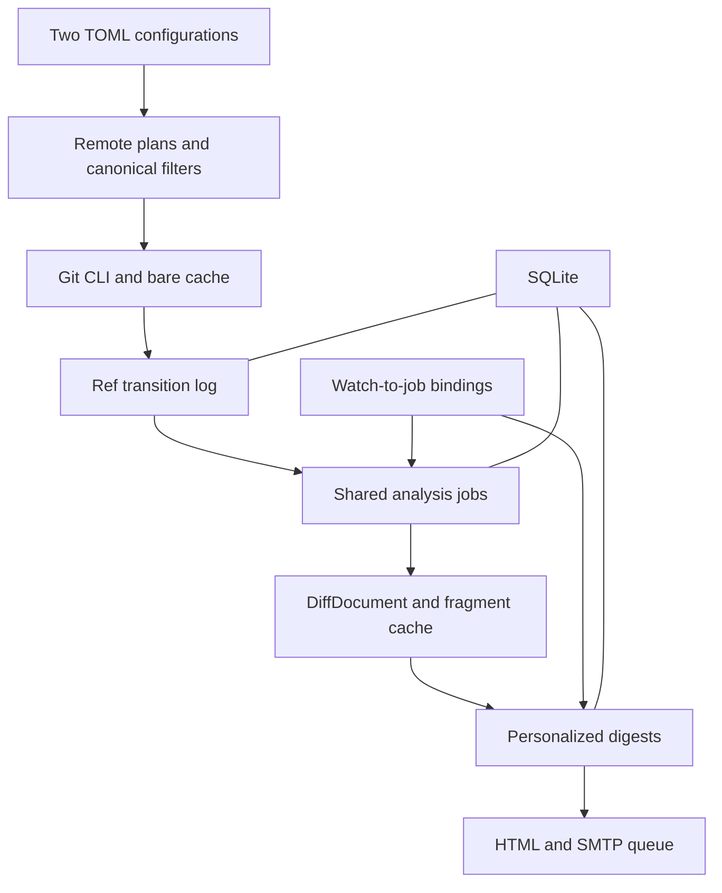
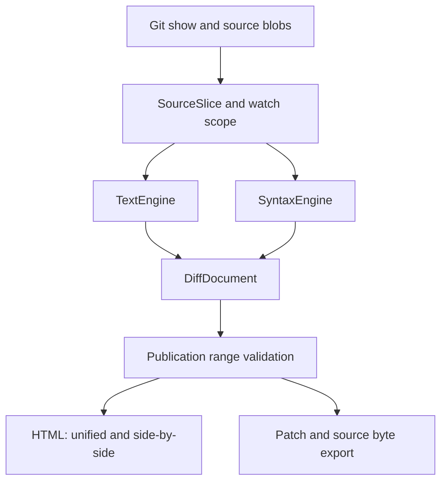

# Git Monitor — Standalone Rust Application Architecture

Git Monitor is a standalone Rust application for monitoring multiple repositories, remotes, and branches. It fetches changes into a shared Git cache, selects files or functions of interest, and sends each recipient a personalized digest with a self-contained HTML attachment.

Version 0.3 decisions, October 21, 2026: Rust, system Git, application-owned textual and structural diff engines with a shared HTML renderer, SQLite, two TOML configuration files, and independent state for each remote. Configuration is frozen for the entire run; the application stops through graceful shutdown. History is traversed as a list of commits, with git show invoked for each; functions are selected by a path and an expression with Git -L semantics. Identical computations are shared; recovery, resource limits, tests, and benchmarks are included in the first working slice.

## Core Decisions

| Area | Decision |
| --- | --- |
| Execution | git-monitor binary and system Git; the application owns diff processing and HTML |
| Repositories | Managed bare repositories in a configurable directory |
| Multiple remotes | A logical repository contains origin, upstream, and other sources |
| Branch state | Separate state per repository, remote, source generation, and full refname |
| Fetching | Shared fetch for all subscriptions to a particular remote |
| Filters | All selected branches, specific branches, or globs; paths or a function in a file |
| Events | Commits, branch creation, branch deletion, and history rewrites |
| Notifications | Personalized batches of changes across multiple repositories |
| Diff | TextEngine with delta-level viewing capabilities and a Tree-sitter-based SyntaxEngine; a shared DiffDocument |
| Report | A short email and self-contained HTML with embedded CSS, JS, and data |
| Reuse | Canonical filters, shared analysis jobs, and a render cache |
| Validation | Tests and a benchmark harness from the first commit; a baseline before optimization |
| Recovery | Unfinished fetch attempts are recovered before another fetch; analysis and delivery have separate retries |
| Lifecycle | FrozenConfig per run, SIGTERM/SIGINT handling, and preservation of unfinished work |

The application owns the repository directory. User working copies, an HTTP service, a management UI, and tracking functions across file moves are outside the first version's scope. An operator manages configuration changes; recipients may have different sets of subscriptions.

## Repositories, Remotes, and Branches

A logical repository groups related Git sources, such as a private fork and its upstream. It has a single object database: identical objects from multiple remotes are physically reused. All remotes within a logical repository must use the same object ID format; an incompatible source belongs in a different logical repository.

Repository and remote identifiers are stable configuration keys. Names such as origin and upstream are ordinary identifiers: origin has no special privileges or priority.

| Entity | Example |
| --- | --- |
| Logical repository | llvm |
| Remote | origin or upstream |
| Source branch | refs/heads/main |
| Local ref | refs/remotes/origin/main |
| Another local ref | refs/remotes/upstream/main |
| Observation key | llvm, origin, source_epoch, refs/heads/main |

Identical SHAs in origin/main and upstream/main allow analysis cache reuse. A commit appearing in each of these refs remains a separate event. Reports always identify the remote alongside the branch.

The source epoch changes when a source URL or access context is replaced. A new source receives an initial snapshot; the previous source's history does not turn into mass branch-deletion events. Removing a remote or branch from configuration stops monitoring it. In the first version, renaming an identifier is treated as disabling the old source and adding a new one.

## Configuration and Data Layout

The application reads exactly two user configuration files: monitor.toml and mail.toml. The first contains storage locations, sources, recipients, and filters. The second contains SMTP and sender settings. Both files are read and validated once at startup; after environment variables are resolved, an immutable FrozenConfig is created. Files are not reread during execution. Settings are changed through graceful shutdown followed by a new run; SIGHUP is logged and ignored, and reloading is not supported. Each run --once invocation is a new run.

All relative paths are resolved against the directory containing monitor.toml, regardless of the process working directory. The mail.toml path is supplied through a separate CLI option. Repository IDs and remote IDs are restricted to lowercase Latin letters, digits, hyphens, and underscores; an identifier cannot contain path components.

```toml
version = 1

[storage]
repositories_dir = "/var/lib/git-monitor/repos"
state_dir = "/var/lib/git-monitor/state"

[execution]
max_fetches = 4
max_fetches_per_host = 2
max_analyses = 4
git_timeout = "3m"
bootstrap_timeout = "30m"
shutdown_grace = "60s"

[defaults]
poll_every = "5m"
digest_every = "1h"
new_branch_mode = "summary"
max_message_bytes = 15000000

[diff]
mode = "auto" # text, syntax, auto
layouts = ["unified", "side-by-side"]
theme = "light"
line_numbers = true
moved_lines = true
line_algorithm = "histogram"
context_lines = 3

[limits]
max_blob_bytes = 32000000
max_patch_bytes = 64000000
max_job_output_bytes = 128000000
max_worker_address_space_bytes = 1073741824
analysis_timeout = "30s"
syntax_timeout = "5s"
max_syntax_nodes = 500000
max_syntax_candidates = 1000000
max_alignment_cells = 1000000
max_part_count = 100

[recipients.maxim]
to = ["maxim@example.org"]

[recipients.team]
to = ["team@example.org"]
digest_every = "24h"

[repositories.llvm]
[repositories.llvm.remotes.origin]
url = "ssh://git@git.example.org/toolchain/llvm-project.git"
poll_every = "5m"

[repositories.llvm.remotes.upstream]
url = "https://github.com/llvm/llvm-project.git"
poll_every = "15m"

[[watches]]
id = "asan-updates"
repository = "llvm"
remotes = ["origin", "upstream"]
recipients = ["maxim"]
branches = { include = ["main", "release/*"] }
paths = ["compiler-rt/lib/asan/**"]
events = ["commits", "branch_created", "branch_deleted", "history_rewritten"]

[[watches]]
id = "thread-start"
repository = "llvm"
remotes = ["upstream"]
recipients = ["maxim"]
branches = { include = ["main"] }
function = { path = "compiler-rt/lib/asan/asan_thread.cpp", match = 'ThreadStart' }
events = ["commits", "branch_created", "branch_deleted", "history_rewritten"]

[[watches]]
id = "libcxx-all-branches"
repository = "llvm"
remotes = ["upstream"]
recipients = ["team"]
branches = { all = true }
paths = ["libcxx/**", "libcxxabi/**"]
exclude_paths = ["**/test/**"]
events = ["commits", "branch_created", "branch_deleted", "history_rewritten"]
```

Branches are selected using either all = true or include with an optional exclude. These choices are mutually exclusive. In branch and path globs, * does not cross /, while ** does; all branches are selected through all = true. Paths are relative to the Git tree root and are case-sensitive.

A watch specifies either paths with optional exclude_paths, or function with one exact path and a Git expression. Omitting both means monitoring all content in the selected branches. Repository, remotes, branches, and content are combined with AND; multiple watches are combined with OR. Multiple matching watches become reasons for including a single change in the digest.

For branch_created and branch_deleted, repository, remote, and branch filters apply. Content filters do not suppress these events. History_rewritten is always shown for a selected branch, with its diff restricted to the selected content. During the first synchronization, existing branches form an initial snapshot. New watches and newly added filter scopes receive an initial baseline; historical backfill is a separate operation.

When an existing watch changes, continuously monitored scopes that remain allowed retain their queue and progress. Added scopes receive their own initial baseline at the first confirmed observation; they do not reset progress for existing scopes. Changing addresses, the digest interval, or presentation settings does not change the selector version.

New_branch_mode = summary produces a new-branch card with its SHA and starts monitoring. An additional compare mode requires an explicit base_remote and base_branch; the report names this base. It is a comparison against the selected base, not a claim about where the branch originated.

```toml
version = 1

[smtp]
host = "smtp.example.org"
port = 587
security = "starttls"
username = "git-monitor@example.org"
password_env = "GIT_MONITOR_SMTP_PASSWORD"
from = "Git Monitor <git-monitor@example.org>"
timeout = "30s"
```

mail.toml may use password instead of password_env; the two cannot be specified together. A file containing a secret is accessible only to its owner. Git uses standard SSH settings and credential helpers. Example addresses and URLs are not a live configuration.

| Path | Contents |
| --- | --- |
| repositories_dir/llvm.git | Bare repository containing all llvm remotes |
| state_dir/state.sqlite3 | Observations, jobs, matches, digests, and deliveries |
| state_dir/artifacts/ | Prepared HTML and complete MIME messages |
| state_dir/tmp/ | Temporary analysis data |
| state_dir/instance.lock | Protection against two concurrently running instances |

Configuration validation detects unknown remotes and recipients, duplicate watch IDs, invalid globs, conflicting selectors, and incompatible options. Function validation against a particular source file is separate from syntactic configuration validation. Directories are created at startup; changing repositories_dir does not automatically move or delete existing data.

## Application Components



| Rust module | Responsibility |
| --- | --- |
| config | One-time loading of both files, FrozenConfig, selector and delivery-setting versions |
| lifecycle | Signals, stopping new work, the shutdown deadline, and recovery before a new run |
| domain | Identifiers, OIDs, ref keys, event kinds, and job states |
| scheduler | Remote intervals, backoff, per-host limits, and digest deadlines |
| git | Git CLI, managed bare repositories, refs, commit graphs, diffs, and object retention |
| collector | Remote snapshots, transition detection, and event persistence |
| planner | Canonical filters, merging identical requests, and watch bindings |
| analysis | Shared commit, path, and function analysis; extraction of restricted source ranges |
| diff | TextEngine, SyntaxEngine, line and token alignment, moves, and versioned DiffDocument |
| store | SQLite transactions, jobs, progress, migrations, and attempts |
| digest | Digest boundaries, recipients, and match aggregation |
| render | Application-owned HTML/CSS/JS, unified and side-by-side views from a shared model, pagination, and safe copying |
| mail | MIME, SMTP, retries, and outcome tracking |
| cli | Execution, configuration validation, diagnostics, and local previews |

A single Cargo package contains the binary and a library with internal modules. Additional crates are introduced only when there is a concrete reuse need. Domain does not depend on SMTP, SQLite, or process execution; orchestration calls concrete adapters through small contracts.

Core contracts: GitBackend returns RemoteObservation, CommitDelta, and content by OID; Collector turns observations into RefEvent; QueryPlanner binds watches to shared AnalysisRequest values; ChangeAnalyzer returns SharedAnalysisResult and allowed source ranges; DiffEngine returns DiffDocument with coordinates and typed annotations; ScopeProjector removes anything outside the watch scope; Fanout binds results to each matching watch; DigestBuilder creates a frozen digest; Renderer produces HTML and report parts; MailTransport returns an SMTP attempt result. Observation types include covered ref scopes and the source epoch, so narrowing configuration does not look like branch deletion. Diff engines return neither HTML nor ANSI, and the renderer does not access Git.

The practical dependency set is clap for CLI, serde and toml for configuration, Tokio for processes, signals, and timers, rusqlite for SQLite, lettre for MIME and SMTP, Askama for HTML, globset for globs, and tracing for logs. Selected sequences are compared using similar with byte-aware APIs and deadlines; parsing and highlighting use tree-sitter and tree-sitter-highlight with pinned grammars. The application-owned SyntaxEngine matches syntax trees; it does not need difftastic's internal Rust APIs or a parser for its terminal output. Delta and difft are allowed only as external development references for quality comparisons; users do not need to install them. Dev-dependencies include Criterion and proptest. Versions and the MSRV are pinned during implementation; Cargo.lock is committed. Function expressions are passed to Git without rewriting them as Rust regular expressions. Git is executed with argument lists and no shell; refs use machine-readable formats, and path lists use NUL separators. Human-readable stderr is not an event protocol.

One dedicated worker serves SQLite. Synchronous rusqlite queries and lengthy report generation do not block the async executor. Heavy analysis runs in a bounded number of isolated git-monitor worker processes; results are exchanged through validated artifacts, and the control channel has a size limit. Tokio manages Git and worker processes; timeouts terminate child process groups and wait for them to exit, while stdout and stderr handlers prevent full-pipe deadlocks. Limits apply to patch generation, analysis, rendering, and packaging, not just the finished email. On Unix, max_worker_address_space_bytes limits address space through RLIMIT_AS; this is not an RSS metric. Other platforms require an equivalent mechanism; doctor detects unsupported mandatory hard limits before jobs start.

## Fetching Changes from Multiple Remotes

The scheduler builds a separate FetchPlan for each remote from the union of active watches. Fetch frequency is independent of email frequency. Different logical repositories can update concurrently; mutating Git operations within a bare repository are serialized. This rule covers fetch, application refs, and maintenance.

A separate fetch is issued for each remote. A successful origin fetch is not rolled back because upstream failed. Each source has its own last_attempt_at, last_success_at, next_poll_at, and error status. Atomic Git ref updates within one fetch do not extend to SQLite or other remotes.

Monitoring all branches uses the source's full refspec:

```bash
git -C /var/lib/git-monitor/repos/llvm.git fetch \
  --atomic --prune --no-prune-tags --no-tags --no-recurse-submodules \
  --no-auto-maintenance --no-write-fetch-head --porcelain \
  origin --refmap= '+refs/heads/*:refs/remotes/origin/*'
```

upstream uses its own refs/remotes/upstream/* namespace. Application refs live outside these namespaces and are not affected by remote pruning. Automatic tag pruning is explicitly disabled so Git settings cannot affect the shared tag namespace.

For a narrow branch selection, Collector first obtains a successful list of visible refs through ls-remote and persists the desired snapshot in FetchAttempt. Changed or missing objects are downloaded into temporary refs belonging to that attempt, without updating published refs/remotes. Branch absence is determined by successful discovery: fetching an exact branch that has disappeared may fail. Fetched OIDs are checked against the desired snapshot; a race that leaves a required object unavailable triggers fresh discovery. Only after all objects are available does a single update-ref --stdin transaction publish updates and deletions, checking expected old OIDs, together with an application marker containing the observation manifest hash. Intermediate download refs are not a RemoteObservation before publication. An empty desired snapshot is published in the same way.

The comparison scope contains only refs covered by the current plan. Expanded scopes receive an initial snapshot; excluded scopes stop being monitored. Comparing all local refs after a narrow fetch does not establish the state of branches that were not checked.

The per-remote cycle runs under the repository write lock:

1. Recover every unfinished FetchAttempt for the repository before any new network request, ref cleanup, source epoch change, or maintenance. Recovery uses the attempt's saved context, even if the new run loaded different configuration.

2. Read the previous SQLite snapshot and persist FetchAttempt: its ID, source epoch, original snapshot sequence number, exact FetchPlan, coverage scope, ref namespace, and required rule versions. Pin old OIDs with application refs before mutating operations. Persist the fetching phase before fetch; pin preparation is repeatable.

3. Perform atomic fetch for a full plan, or discovery, download, and atomic publication for a narrow plan. New OIDs remain reachable through published or temporary refs until persistence is complete. Recording the attempt outcome does not require another fetch.

4. Build RemoteObservation from refs and the attempt manifest, compare it with the previous snapshot in the same scope, and identify events. A subsequent fetch must not overwrite an unprocessed local result.

5. In one SQLite transaction, persist events, jobs, the new snapshot, and FetchAttempt completion. Persistence is idempotent by attempt ID and original snapshot version; the same old/new pair in another attempt remains a separate transition.

6. After committing, hand jobs off for independent processing, remove unnecessary temporary refs, and release the lock. Pins for active jobs remain.

In full mode, published refs are changed by only one atomic fetch within a known FetchAttempt. If the process is interrupted before recording the outcome, recovery reads these refs first: an atomically changed state is finalized as an observation marked interrupted, while unchanged state creates no events. An ambiguous process status alone does not prove branch absence. In narrow mode, recovery accepts only completed atomic publication with a marker; an unfinished download does not become a deletion. Git capability tests verify atomic updates and pruning, including deletion of the final branch; unsupported combinations are not run with weaker guarantees.

fetch --porcelain output is useful for status and diagnostics; durable comparison relies on the saved attempt and SQLite snapshot. A definitively failed fetch with no ref changes does not advance the snapshot. Authentication or network failures do not create branch_deleted. Application markers and manifests are outside remote pruning.

Required scenario: SQLite=A, fetch receives B, the process crashes before the transaction, and the remote has already returned to A. At startup, the recovered A → B transition is persisted first, followed by the new B → A transition. This rule also applies after SIGKILL; graceful shutdown reduces the need for recovery but does not replace it.

## Branch Events and Commit Ranges

| Previous state | New state | Event |
| --- | --- | --- |
| No ref | OID exists | branch_created |
| OID A | Same OID A | No event |
| OID A | Descendant B | branch_updated |
| OID A | OID B that does not continue A | history_rewritten |
| Ref exists | Ref absent from confirmed scope | branch_deleted |

The normal commit stream is computed separately for each old_oid..new_oid transition. First, git rev-list --reverse --topo-order old_oid..new_oid returns the complete list of newly reachable commit OIDs. This traversal does not use --first-parent: commits from merged branches must also be analyzed. Ranges for different branches are not combined into a single exclusion list. A commit may be new to one branch and already known to another.

For each OID, parents and a machine-readable list of changed paths are read first; after filtering, git show generates patches only for selected files. Basic invocations without a shell:

```bash
git rev-list --reverse --topo-order OLD..NEW
git show --format= --raw -z --no-abbrev --no-renames \
  --diff-merges=first-parent --no-ext-diff --no-textconv COMMIT
git --literal-pathspecs show --format= --patch --no-color --no-renames \
  --diff-merges=first-parent --no-ext-diff --no-textconv \
  --diff-algorithm=histogram --unified=3 COMMIT -- PATH
```

OLD, NEW, and COMMIT are replaced with validated OIDs; PATH is passed as a separate literal argument. raw -z output supplies paths, modes, and blob OIDs; patch text is not the sole filename protocol. A root commit is compared with an empty tree. --diff-merges=first-parent applies to each commit's representation, including merges with any number of parents, and does not exclude side-branch commits from rev-list. Combined diff is not an input format in the first version. The application profile fixes Git diff rules and disables external helpers; implicit user settings cannot change the protocol format.

For history_rewritten, the report contains an old → new diff, incoming commits from old..new, and outgoing commits from new..old. Rolling back to an ancestor is therefore visible even when old..new is empty. The old OID is pinned until analysis results are persisted.

Branch creation produces a remote/branch card with its OID. Deletion produces a card with the last observed OID; it does not mean every repository file was deleted. Deleting and recreating the same ref in separate observations produces two events. A physical branch rename is represented as deletion and creation.

For a merge, git show is invoked with explicit --diff-merges=first-parent: changes made during conflict resolution must be visible even when they appear in no ordinary commit. Incoming commits are shown as a nested list. The aggregate old → new diff is an additional view. History is a DAG: intermediate events belong to specific parent/commit pairs rather than being presented as a single timeline of branch state. A merged commit's patch and a similar merge patch retain distinct reasons; deduplication does not erase provenance. Identical commit OIDs within a digest are grouped with all matching remotes and branches listed, while the association with each ref is preserved.

Polling records observed states and available history. A branch created and deleted between checks, or inaccessible intermediate force-pushes, may go unnoticed. Observation time is not presented as push time.

## File and Function Filters

The analyzer traverses the rev-list output and obtains CommitDelta through git show for each commit. All watches share the inexpensive raw list of changed paths; patches and blobs are read only after selection. A file matches by its old or new path; moving out of a monitored scope is shown as deletion from that scope. Renames without heuristic detection are represented as delete/add. Submodules are shown as gitlink changes, and Git LFS as pointer-file changes; recursive downloading is disabled.

A function selector is an exact path and the func expression from git log -L :func:path. The first match is selected according to Git's rules; line numbers and qualified names are not permanent identities. A rename that stops the expression matching is recorded as disappearance. No search for a new function or another file is performed. Range selection retains Git -L semantics; history traversal and commit patch generation are separate operations.

For each required snapshot, FunctionRangeResolver returns SelectedRange with byte offsets, original line numbers, and an effective-rule fingerprint, or NoMatch/AnalysisError. A practical adapter creates an application-only root commit with the snapshot's tree and runs git log -L on that single commit: the added range supplies exact boundaries. The temporary commit is pinned during extraction, excluded from displayed history, and never sent externally. Range contents come from the original blob rather than being reconstructed from colored output. NoMatch is distinguished from an unavailable blob, an invalid expression, and Git failure; the adapter has capability tests and a controlled locale. An unknown failure is not treated as function absence.

For each applicable parent/commit pair, ranges are extracted from both versions, including a merge relative to its first parent; a root commit has an empty old side. Git show identifies commit changes, and function watches then compare the selected source ranges. A hunk containing the function cannot simply be forwarded: it may contain neighboring code. The diff is built from allowed ranges, with coordinates mapped back to the original file. Moving a range down without changing its bytes does not create function_modified. Neighboring functions and context outside the range are excluded from the report.

| Comparison result | Content event |
| --- | --- |
| No previous match; a match now exists | function_appeared |
| Both versions match; selected range bytes changed | function_modified |
| Previous match; no current match | function_disappeared |
| File deleted | function_disappeared with reason file_deleted |
| Source or required objects unavailable | analysis_failed |
| Range unchanged | No notification match |

At the first check, an absent function means waiting. Every newly reachable applicable commit is checked, so deletion and restoration within one polling window remain visible even when the aggregate diff is empty. For history_rewritten, selected old and new ranges are additionally compared, including rollback to an ancestor with no incoming commits. Commits without matches also advance progress.

Attributes are read separately for each side from its tree through GIT_ATTR_SOURCE or --attr-source. All .gitattributes files along the path and definitions of allowed diff drivers are considered. Standard built-in drivers and explicitly allowed textual xfuncname rules are supported; external diff helpers and textconv are disabled. Allowed driver settings and inherited attributes are frozen for the run and included in the fingerprint; uncontrolled global overrides are not permitted for analysis. SSH access settings and credential helpers remain available.

A .gitattributes change is an uncommon but separate analysis input. The raw list is checked for these paths; watches under the changed scope have old and new effective fingerprints computed even if the source blob is unchanged. A changed fingerprint triggers range extraction again and creates analysis_rules_changed with both rule versions. A range changed solely by rules is not presented as a source edit; if code changes too, both reasons are shown. Both fingerprints are included in the cache key. Re-evaluating active function watches under the affected scope is sufficient; continuous reanalysis of every file is unnecessary.

A notification is triggered by a change to the selected source range or a separate change in analysis conditions. Effects of macros, headers, and called functions are not computed.

## Diff Quality and Presentation Engines

The application owns its diff model and HTML renderer. TextEngine provides line-oriented comparison with delta-level viewing capabilities; SyntaxEngine provides structural comparison in the spirit of difftastic. Delta and difft are neither runtime dependencies nor interchange formats. Their capabilities are quality references, while exact line placement or color matching with a particular version is not a contract. Structural comparison understands syntax; it does not prove program behavior equivalence.

### Shared Diff Model

GitAdapter returns CommitDelta: original paths and modes, blob OIDs, parents, a patch, and a change list. ScopeProjector produces allowed SourceSlice values with original coordinates. TextEngine and SyntaxEngine produce typed DiffDocument values containing no ANSI, HTML, or terminal widths. HtmlRenderer uses only this model and allowed source bytes. A second scope projection after structural matching is mandatory before persisting publishable results.



| Type | Data and invariants |
| --- | --- |
| SourceSlice | Blob OID, original path, mode, byte range, original-file starting position, bytes, and encoding status |
| FileDelta | Old and new paths, modes, change kind, and an absent side for add/delete |
| TextEdit | Equal/Delete/Insert/Replace, nonoverlapping byte ranges on both sides, and association with the canonical patch |
| LinePair | Old and new line numbers or an absent side; alignment for side-by-side |
| Span | Byte range, SyntaxKind, ChangeKind, and optional MoveId; independent annotation layers |
| SyntaxMatch | Node/token correspondence, kind, and confidence; no program semantics computation |
| Hunk | Ranges on both sides, allowed context, edits, line pairs, and continuations |
| DiffDocument | Schema version, engine/profile, sources, text edits, optional syntax matches, hunks, and quality/fallback metadata |

Byte offsets are the primary coordinate system; LineIndex maps them to original lines. UTF-8 boundaries and displayed grapheme clusters are handled separately. Missing final newlines, CRLF, tabs, and invalid UTF-8 are not silently normalized. TextEdit and stored bytes must allow reconstruction of the allowed new side from the old side; structural annotations do not replace this invariant. For a function watch, the selected fragment is reconstructed, and export is labeled as a scoped diff rather than presented as an applicable whole-file patch.

### TextEngine

Canonical file changes come from Git show with a fixed histogram profile. For isolated SourceSlice values, including function ranges, the adapter generates an equivalent Git diff between allowed snapshots using the same profile and coordinate mapping. A function watch's full-file patch is not published. Intraline matching and alignment use similar with deadlines and byte-aware sequences; the application controls presentation.

Blocks of additions and deletions are identified first. Lines within a bounded block are aligned by token similarity; max_alignment_cells limits the matrix, and dissimilar lines remain separate delete/insert operations. After alignment, token diff and, where needed, grapheme diff produce intraline spans. Reaching the budget disables only alignment refinement, with an explicit notice; canonical edits, source bytes, and coordinates are retained. Whitespace and comment changes remain available in the textual view.

Moves are identified through hashes of deleted and added blocks, with mandatory byte verification and deterministic choices for repeated blocks. Search is restricted to selected fragments of the current comparison; cross-file moves are allowed only within the watch's publishable scope. MoveId annotates delete/insert operations without hiding the change. No exhaustive repository-wide copy search is performed.

Syntax highlighting is independent of line diff. Tree-sitter-highlight produces syntax token classes; the renderer selects a palette. The full file may be used locally for lexical context, but spans and bytes are clipped to SourceSlice before packaging. Unsupported languages retain a complete textual diff and intraline highlighting with syntax_highlighting_unavailable. Language support cannot be claimed from an extension alone: it is validated against a corpus.

### SyntaxEngine

Inputs are old and new source texts with Tree-sitter trees and selected ranges. The initial grammar set to validate is C, C++, Rust, Python, and JSON; versions, ABIs, and highlight queries are pinned in the build. Adding a language requires fixtures, coordinate checks, and budget validation. C++ is analyzed syntactically without compile_commands or preprocessor expansion; parse errors in the comparison scope trigger textual fallback.

The algorithm first identifies identical subtrees by type and hash, verifying their contents, then matches remaining nodes using parents and stable anchors, and finally compares leaves and delimiters within bounded regions. Repeated subtrees are resolved deterministically. Budgets limit node counts, matching candidates, source size, and time. This is an application-owned algorithm with a versioned contract; full parity with difftastic's heuristics is not promised in advance.

SyntaxMatch is projected into original byte ranges and LinePair values. Formatting may produce no structural differences; in that case, the notification and textual view are retained with text_only_change. Comments are tracked separately from significant nodes and are not lost. Moves may be shown as node relationships, while the textual layer remains complete.

For function watches, trees may be built from full files for context. Only the selected function ranges enter HTML, JSON, the search index, and exports. If correspondences cannot be reliably projected without neighboring code, TextEngine is used with scope_projection_failed. The AST does not change Git -L rules or start tracking a function moved to another file.

text mode uses TextEngine; syntax requests a structural view with mandatory explicit fallback; auto chooses a structural view when the language is supported, parsing is reliable, and the budget is sufficient. Distinct fallback reasons are unsupported_language, parse_error, syntax_budget_exceeded, scope_projection_failed, and engine_error. A textual view is also available after successful structural comparison. Exceeding the overall source or analysis limit is oversized_item/analysis_failed rather than a successful empty diff.

### Application-Owned HTML Renderer

| Capability | Contract |
| --- | --- |
| Syntax and intraline highlighting | Independent syntax and change spans, CSS themes, and a legend |
| Unified and side-by-side | A single edits/LinePair model; switching without Git execution or recomparison |
| Structural and textual views | Switching annotations for one change with explicit engine/quality |
| Line numbers | Original-file coordinates, including scoped function diffs and parts |
| Long lines | CSS wrapping or horizontal scrolling; no silent tail truncation |
| Moves | Linked MoveId values and navigation between allowed blocks |
| Themes and layout | Light/dark themes and responsive width; CSS changes do not require diff recomputation |
| Navigation | Local anchors for files, hunks, functions, events, and continuations |
| Copying and export | Source bytes separate from line numbers, diff markers, and presentation |

HtmlRenderer generates self-contained HTML/CSS/JS directly from DiffDocument. Unified content is readable without JS; interactive side-by-side and structural annotations use the same allowed model. If only side-by-side is selected, a readable prerendered representation remains available. The attachment requires no terminal-to-HTML conversion. Window width changes affect CSS and do not enter DiffKey; theme and layout belong to RenderKey.

Code, paths, authors, and commit messages are escaped as data. JSON embedded in HTML is safely encoded, including < characters and closing script sequences; source text is never inserted through innerHTML. Control bytes are displayed as visible notations rather than interpreted as ANSI. UTF-8 is copied as text; other data has an exact byte download with encoding information, and byte preservation is verified through export. Search and folding do not include hidden data from other watches. Large documents are split into bounded parts before DOM construction.

The application-owned engine is validated with a capability matrix and a corpus of source pairs. Delta and difft may serve as development references with recorded versions; different heuristics alone are not an error. Blocking invariants are complete changes, byte reconstruction, correct coordinates, scope boundaries, no truncation, and readability without JS.

## State and Recovery

| Store | Purpose |
| --- | --- |
| repositories and remotes | Stable IDs, directory, object format, source epoch, and scheduling |
| fetch_attempts | Previous snapshot, frozen plan, scope/source epoch, fetching and recovery phases |
| ref_states | Last confirmed OID per ref and state version |
| ref_events | Immutable old → new events and observation sequence |
| analysis_jobs | Shared work by unique QueryKey with a lease |
| watch_jobs | Bindings between an event, watch, watch version, and shared work |
| query_results and diff_results | Analysis results, DiffDocument, and quality, including empty matches |
| config_revisions and watch_bindings | Nonsecret rule snapshots, selector versions, scope activation boundaries, and recipient bindings |
| matches | Filter results, diff fragments, and inclusion reasons |
| digests and digest_items | Recipient, frozen digest boundary, and selected results |
| deliveries | MIME parts, Message-ID, state, and SMTP attempts |
| object_pins | Application refs retaining required old objects |

An OID is stored as GitOid with the repository's known format; SHA-1 length is not hardcoded in business logic. An event has its own ID and sequence number. The old/new pair is not a unique key: an A → B transition can occur again.

Two progress tracks are separate. The ref snapshot advances after events and jobs have been persisted. Watch progress advances after its analysis result is persisted, including no-match results. Delivery has independent state and does not control Git fetching.

An analysis job is unique by canonical QueryKey. A watch_jobs binding is unique by event ID, watch ID, and watch version; several bindings may wait for one result. A running job has a lease, and expired leases return to pending after restart. An empty result is persisted as successful. Results and Match values are written idempotently; event provenance and consumer lists survive retries. Canceling one watch does not cancel shared work required by others. At a new run, watch bindings are checked against FrozenConfig. Revoked scopes do not produce new deliveries; saved results and jobs for still-allowed scopes are not discarded solely because the configuration version changed. Unchanged selectors and existing scopes within additive expansions continue their progress; added scopes receive a separate activation boundary. An incompatible selector replacement ends the previous observation and creates a new boundary; canceled bindings are recorded in the log. Errors are stored separately and retried according to policy rather than becoming empty results.

| Failure point | Behavior after restart |
| --- | --- |
| After fetch, before event persistence | Complete the saved FetchAttempt from the local result before any subsequent fetch |
| After event persistence, before analysis | Resume persisted analysis jobs |
| After analysis, before digest assembly | Include saved matches in a later digest after checking the new run's FrozenConfig |
| During shutdown or after SIGKILL | Resume pending work and recover expired leases; recover Git attempts first |
| After HTML creation, before digest commit | Remove or reuse the unbound temporary artifact |
| After digest commit, before SMTP | Send the persisted MIME message |
| After SMTP acceptance, before recording sent | A retry is possible; the existing Message-ID is reused |

There is no atomic transaction across Git, the filesystem, and SQLite. FetchAttempt, pins, and mandatory recovery before the next fetch close the Git → SQLite gap. Artifacts are first written to temporary files, synchronized, atomically renamed with directory synchronization, and linked to database records; SQLite durability settings match this contract. Maintenance removes unbound files after recovery. A worker result is accepted only with a current lease/attempt token, preventing a completed stale attempt from overwriting a newer result.

SMTP supports repeatable delivery attempts, not universal exactly-once delivery. An ambiguous connection outcome can produce a duplicate. A stable Message-ID helps identify a digest but does not guarantee mail-server deduplication.

## Per-Run Configuration and Graceful Shutdown

At startup, the application acquires instance.lock, reads both configuration files once, checks capabilities, and builds FrozenConfig. It then recovers unfinished FetchAttempt values in their saved context, reconciles queues with the new configuration, and only afterward enables the scheduler, SMTP, and maintenance. config_revisions stores only required nonsecret rule versions; passwords and credential-helper values are not written to SQLite. Collected results remain audit data regardless of later notification cancellation.

During execution, changes to TOML files or the environment do not change subscriptions, addresses, or SMTP parameters. Neither the scheduler nor the sender rereads files before working. The operator applies changes by stopping and restarting the application. At the new run, changing only an address or interval rebuilds pending delivery without resetting analysis. For additive watch expansions, saved jobs and matches for the previous scope are retained; for narrowing, individual items are projected again into the newly allowed scope, and revoked items are canceled with a reason. If safe projection cannot be established, the item is not sent and is marked revoked_scope rather than treated as a successful absence of changes. A prepared MIME message whose content or address changes receives a new delivery revision; ambiguous previous attempts remain in the audit log.

| Phase | Behavior |
| --- | --- |
| Running | The scheduler accepts work; one FrozenConfig is used |
| Quiescing | The first SIGTERM/SIGINT prevents new fetches, leases, digests, and SMTP attempts |
| Draining | Already started operations finish within shutdown_grace; results and states are persisted |
| Stopped | Processes are reaped, temporary results accounted for, the SQLite worker stopped, and the lock released |

Shutdown does not try to process the entire persisted queue or send a daily digest early. An active fetch is finalized through observation persistence when possible. Active analysis either saves a completed result or releases its lease after the worker stops. An active SMTP attempt receives bounded time to complete; a disconnect after possible server acceptance is recorded as uncertain, and a retry uses the same Message-ID if the address and MIME message are unchanged. SQLite remains available until these records are finalized.

When shutdown_grace expires or another signal arrives, child process groups are terminated and reaped; unfinished FetchAttempt values and pending jobs remain for recovery. SIGKILL and power loss use the same recovery protocol at the next startup. Normal completion of run --once also waits for started operations. systemd TimeoutStopSec must exceed shutdown_grace with room for process termination and final writes. New settings apply only after the old instance stops; changing a file alone does not revoke access from an active FrozenConfig.

The instance lock protects state_dir; a per-repository lock/ownership marker additionally prevents two independent state_dir instances from concurrently using the same repositories_dir. All mutating Git operations and recovery obey this lock.

## Personalized Digests and HTML

A digest belongs to one recipient ID and contains changes from all of that recipient's watches across multiple repositories and remotes. Its delivery deadline is determined by the recipient's digest_every. A value of 0s collects all ready results into one digest at the end of the current pass. The digest freezes an event cutoff and included Match IDs; later events go into the next digest.

The digest includes completed jobs up to its cutoff. Failed jobs get their own error records; late results from reanalysis enter a subsequent digest with their original observation time. Inclusion uses unpublished Match IDs, so an older event sequence number does not exclude a late result. Processing gaps are not presented as evidence of no changes.

The email contains text/plain and simple text/html summaries; the self-contained report is a separate text/html attachment. The attachment includes CSS, a small amount of JS, and all required data. It does not contact an HTTP service, CDN, or external fonts. A function watch includes only the selected range and its diff.

The report provides repository → remote → branch → file navigation, application-owned syntax and intraline highlighting, textual and structural views, unified and side-by-side layouts, line numbers, untruncated long-line wrapping, search, folding, and event filters. Aggregate diff and history are separate views. Branch creation and deletion are clearly distinguished from file changes. Each fragment identifies its engine, model version, quality/fallback, matching watches, and sources.

Base content is prerendered and readable with JS disabled. Interactive features target a saved attachment opened in a browser; an email client's built-in preview may restrict them. Code, paths, and commit messages are escaped as data. UI switches do not merely hide data unavailable to a recipient: such data is excluded from the file entirely.

Max_message_bytes limits the exact serialized MIME bytes, including encoding and headers. Size is checked as a stream before deliveries are committed. A digest is split into independent numbered parts with a shared cutoff and manifest. Boundaries first fall between files and hunks, then inside a hunk when necessary. Each part contains a file header, original coordinates, continuation numbers, minimal context within the allowed scope, and its own CSS/JS. A changed line or large function range is not indivisible.

A line that does not fit on its own is split into byte ranges at UTF-8 boundaries where the encoding is valid; each fragment shows the original line number and byte range. Every fragment's export preserves exact bytes, and the manifest records assembly order and the hash of the complete allowed content. The application must not endlessly attempt to package the same indivisible item or silently truncate its tail. Part identifiers and Message-ID values are finalized after size validation; a packaging change creates a new delivery revision. Minimum message size and max_part_count are checked before queue creation.

Separate limits bound blob size, patch size, total job output, worker address space, analysis time, syntax nodes, and the alignment matrix. Git/worker stdout is bounded and spooled to disk when needed; exceeding a limit stops the operation and creates oversized_item with its reason and available sizes/OIDs. If the syntax budget is exhausted, explicit textual fallback is allowed within the overall budget. Exceeding the overall budget or max_part_count does not become a successful empty diff: the recipient receives a small diagnostic card, any complete scoped artifact already created is retained locally, and other changes continue to be delivered. To obtain a full result, the operator raises the limit and explicitly retries the selected job. Resource failures are not retried indefinitely with unchanged limits.

Size validation occurs after scope projection; a full file from another scope cannot be attached instead of an oversized function diff. Diagnostic cards, manifests, and exports also contain only sources allowed for the recipient. Binary objects remain metadata unless a separate contract requests their contents.

Before a digest is created or sent, bindings are checked against the current run's FrozenConfig. Configuration files are not reread. Pending digests are rebuilt after settings change at the next startup, before SMTP is enabled; the lifecycle section's rules for preserving allowed matches and revoking scopes apply. Digests store selector, recipient-binding, and delivery versions separately. A new scope's baseline does not cancel unsent results from the previous scope; a newly added interest is not automatically backfilled.

The process operator is trusted and can access all local caches. Recipient scopes are defined by watches and remotes in configuration. Path and function filters express interests; a separate ACL system for parts of a source repository is outside this version's scope.

## Filter and Computation Deduplication

Deduplication is enabled in the first working slice. QueryPlanner canonicalizes conditions, merges identical requests, and preserves each watch binding. Fetch is already shared per remote; graph reads, path lists, range extraction, expensive comparison, and HTML fragments are also shared.

Recipient addresses, watch IDs, signatures, and delivery intervals are excluded from computation keys. Path case and Unicode are preserved, and function expressions are passed literally. Canonicalization sorts and deduplicates elements only where ordering does not affect the specified set semantics. Equivalence of different regular expressions is not proven.

| Layer | Key and reuse conditions |
| --- | --- |
| Canonical filter | Schema version, source and branch scopes, paths or function, and selection policy |
| CommitKey | Repository/object format, commit and selected parent, Git show profile, Git version, and attribute rules |
| QueryKey | Cache scope, old/new OIDs, selector, traversal/parent rules, analyzer/Git versions, and rule fingerprints for both sides |
| ParseKey | Cache scope, blob OID, language, Tree-sitter/grammar versions, and parsing profile |
| DiffKey | Hash of inputs and ranges, engine, DiffDocument version, algorithms, grammars, and budget/fallback profile |
| RenderKey | Scoped DiffDocument, renderer version, layout, theme, style, and splitting profile; window width does not affect the diff |

The raw changed-path list is read once per CommitKey and shared by all filter groups; the same commit in several transitions does not trigger repeated git show calls with identical inputs. Blob contents are batch-read and cached. Once a specific transition is selected, filters for different branches may reuse a computation if their actual inputs match. Different old/new values, attributes, traversal policies, or access scopes produce different QueryKey values.

One analysis job runs per QueryKey. In-flight coalescing attaches concurrent consumers to existing work. A unique SQLite key and lease protect against duplicate starts after restart. Successful empty results are cached; temporary failures do not become permanent empty results. Input object pins are retained until all dependent shared work completes.

If 100 recipients watch one function in the same transition, one expensive analysis and one render per presentation profile are expected. Personalized MIME construction and delivery run per recipient. Different themes or layout sets add RenderKey values while retaining shared analysis. Personal inclusion reasons, watch names, and sources are added over the shared fragment during packaging rather than contaminating its cache with other bindings. Raising limits after oversized_item changes the attempt profile; a previous resource failure does not prevent an explicit retry.

Ref events and watch bindings remain independent: a commit in origin/main and upstream/main may require two notification bindings. Within one personalized digest, an identical fragment combines inclusion reasons. Each recipient undergoes its own selection before packaging; a fragment cache does not imply a shared file containing other recipients' sources.

The first version merges exact canonical matches and common low-level inputs. Overlapping but different filters may require separate analyses. This bounds planner complexity; benchmarks establish the value of further merging, and correctness is checked against a naive executor.

## Performance and Maintenance

Fetch runs per remote rather than per subscriber. When nothing changes, only refs are checked. Content is downloaded incrementally and shared by all watches. Matching version pairs and analysis conditions reuse a result; an identical new OID with different starting points is insufficient to merge history traversal.

Initial downloads use bootstrap_timeout; incremental operations use git_timeout. Individual branches use discovery and downloading of changed refs; all-branch monitoring uses direct fetch without a mandatory preliminary request. Schedules include jitter, and failures use capped exponential backoff. The maximum detection delay remains explicitly configurable through poll_every. Disabled sources are not polled.

The main mode stores complete Git objects for the available history of selected refs, keeping analysis local. Shallow cloning is not the default. Blobless mode can be added after measuring bootstrap and load; multiple promisor remotes require separate validation of missing-object routing.

Path globs are applied before patch generation. Functions are analyzed when the source path or its effective range rules change; attribute changes use a separate inexpensive selection check. QueryPlanner merges identical computations and caches immutable inputs. Blob size is checked with cat-file before loading; reads are batched and bounded. Application-owned moved-block detection is restricted to the selected diff; exhaustive repository-wide rename and copy searches are disabled. Commit graphs and repacking are handled by a separate task after recovery.

GC runs under the repository write lock. Application refs retain active starting points, unfinished FetchAttempt values, and unprocessed events; pins are released after required fragments are persisted and dependent jobs complete. Old digest artifacts and logs follow a separate retention policy; unfinished delivery is not removed automatically.

Structured logs include repository, remote, event ID, watch, and digest ID. Diagnostics show each remote's last successful check, fetch duration, Git cache size, analysis queue, pending-delivery age, and latest attempt outcome. SMTP secrets and credentials in URLs are redacted from logs. Additional metrics include total and unique filter counts, shared AnalysisRequest counts, Git and diff process counts, per-stage cache hits, wall time, CPU time, memory, and artifact size. The method for measuring child-process resources is recorded with results.

## CLI and Implementation Stages

| Command | Purpose |
| --- | --- |
| git-monitor check-config | Validate both files and cross-entity references without network access |
| git-monitor run --once | One pass of fetching, analysis, and delivery of ready digests |
| git-monitor run | Continuous polling with the same engine |
| git-monitor status | Show source and queue state |
| git-monitor preview --recipient ID | Generate local HTML from saved results without sending |
| git-monitor doctor | Check Git capabilities, directory access, and state integrity |
| git-monitor retry-deliveries | Retry prepared unsuccessful deliveries |
| git-monitor retry-analysis --job ID | Explicitly retry analysis after raising limits or resolving an error |

Configuration paths are supplied through --config and --mail-config. Only one state-mutating instance runs per state_dir. The primary automated execution mode is a systemd timer or cron with run --once; a persistent process uses the same logic and limits. Both modes use FrozenConfig and graceful shutdown; TOML changes apply at the next run. Doctor clearly separates local validation from explicitly requested network diagnostics; an SMTP test is a separate explicit action.

1. Introduce domain, FrozenConfig from both files, directories, lifecycle, GitBackend, and fixtures. The same commit adds SIGTERM/SIGINT handling, bounded shutdown, contract tests, a Criterion harness, operation counters, and planner microbenchmarks; numerical results are saved for implemented scenarios.

2. Implement FetchPlan/FetchAttempt, multiple remotes, snapshots, pins, and recovery before the next fetch. Add rev-list and git show per commit, including first-parent merge patches. Immediately test A → B → A failures, empty remotes, narrow atomic publication, no-op operation, and bootstrap/incremental fetching costs.

3. Add paths, FunctionRangeResolver, attribute dependency checks, QueryPlanner, and versioned caches. Introduce DiffDocument/TextEngine, limits, and scoped export. Test merge conflicts, deletion followed by restoration, and changes only to .gitattributes. Compare shared and naive executors using identical fixtures.

4. Implement the application-owned HtmlRenderer: unified/side-by-side, syntax/intraline spans, moved blocks, copying, self-contained HTML, and personalized MIME. Add splitting within a large hunk/line and oversized_item. Establish end-to-end baseline-v0 for the textual path after the quality matrix passes, before further optimization.

5. Complete reliable SMTP delivery, CLI, maintenance, and shutdown integration across all queues. Add SyntaxEngine: pinned Tree-sitter grammars, matching, projection, and fallback. Structural-mode readiness is evaluated separately from the textual baseline; it is enabled after quality, budget, and neighboring-code leakage tests pass. Each stage includes tests and baseline comparisons.

Tests and benchmarks evolve with every stage. The naive executor is a checked comparison implementation in tests and benches; production execution shares common work. Git tests use deterministic temporary repositories, and delivery is checked against local SMTP. The architecture specification contains no invented measurements: numerical baselines appear when implemented scenarios are run.

## Tests from the First Commit

Tests validate observable behavior and data preservation. Appropriate fixtures and tests accompany the first implemented component; integration checks are added as the full processing path becomes available.

| Group | Properties checked |
| --- | --- |
| Unit and property tests | Canonicalization preserves glob semantics, distinct selectors do not merge, and set permutations preserve results |
| Git integration | Multiple remotes, rev-list/show, root and octopus merges, conflict-resolution changes, pins, atomic pruning, and recovery before fetch |
| Functions | Modification and disappearance, deletion/restoration, line movement without byte changes, neighboring hunks, attributes without source edits, and C++ |
| Deduplication | Naive and shared execution produce identical changes and recipient routing; N identical requests launch one computation |
| Concurrency and failures | Lease fencing, SIGTERM at each stage, deadlines and SIGKILL, A → B → A recovery, immutable FrozenConfig, and queue preservation after watch expansion |
| Diff and HTML | DiffDocument, byte reconstruction from edits, line pairing, syntax/intraline spans, moved blocks, Unicode/invalid UTF-8, no truncation, and readability without JS |
| Scope and MIME | Only allowed ranges in every view/JSON/export, exact MIME sizes, splitting within a hunk or line, max_part_count, and oversized_item |
| SyntaxEngine | Subtree/token/delimiter matching, repetition, comments, parse errors, budgets, text_only_change, and function scope projection |

Property tests and differential checks use a simple naive executor with the same inputs. Adding another recipient does not change an existing recipient's report. Adding a duplicate watch adds an inclusion reason while retaining a single fragment. Changing any result-affecting parameter must prevent incorrect reuse.

The application-owned engine has a corpus of source pairs, expected edits, coordinates, and annotations. Property tests validate allowed-byte reconstruction, line/byte mapping, and scope invariants. delta/difft results may serve as development references with recorded versions and explained differences; identical ANSI or DOM output is not required. Normalized application DOM is supplemented with visual snapshots. Browser tests open self-contained files with network access disabled and check views, responsive width, themes, navigation, search, byte export, and readability without JS. Fuzz targets cover raw/patch parsing, DiffDocument, scope projection, HTML/JSON escaping, and splitting; HTML/script sequences, control bytes, and invalid UTF-8 receive particular attention.

Every PR runs formatting, linting, functional tests, and benchmark-target smoke checks. Correctness failures and deterministic counter regressions block the change. Temporary Git repositories and SMTP fixtures are local; tests do not use real user repositories or actual recipients.

## Benchmarks and Baselines

A Criterion harness for implemented modules and a common result format are created in the first commit. The numerical end-to-end baseline-v0 is recorded for the first minimal complete pass through fetch → rev-list/show → selection → TextEngine → HTML → MIME, before further optimization. The no-deduplication scenario remains a comparison implementation only in tests and benches.

| Scenario | Measurements |
| --- | --- |
| Bootstrap | Cache creation, object fetching, and baseline ref initialization |
| Polling without changes | Ref-checking cost and absence of expensive analysis |
| One changed file | Incremental fetching, selection, diff generation, and packaging |
| Function filter | Function edits, neighboring changes, and disappearance |
| Many refs and remotes | Scaling of discovery, updates, and routing |
| Repeated filters | N = 1, 10, 100, 1000 consumers with U = 1 unique request |
| Distinct filters | U = N; planner overhead without cache benefits |
| Different ranges | The same selector with different old/new inputs is not incorrectly merged |
| One blob in several branches | Reuse of reads and eligible comparisons |
| Expensive diff | Git patches, line pairing, intraline spans, moved blocks, Unicode, and long lines |
| Structural diff | Parse cache, matching, nodes/candidates, scope projection, and fallback |
| Limits | Time and memory until oversized_item, bounded spooling, one large hunk/line, and max_part_count |
| Shutdown and recovery | SIGTERM latency, queue state, and recovery before the next fetch |
| Large digest | Rendering, MIME encoding, and splitting into parts |

Each scenario runs with empty and warm application caches; Git pack, commit graph, and OS cache states are recorded separately. An empty application cache is not called a cold disk. Fixture construction is outside the measured section except for the dedicated bootstrap scenario. Git transport is local and controlled; live GitHub behavior is excluded from the baseline. The source corpus includes C/C++, Rust, Python, and JSON. Commits, dates, test clocks, topology, and generator seeds are fixed.

Measurements cover wall time and CPU, application and child-process memory, Git/diff invocation counts, blob reads, cache hits, original and unique filter counts, Git transfer size, and final MIME size. Transfer size is reported only when a transport counter is actually measured; local pack size is not presented as network traffic. End-to-end measurements retain complete-run distributions and p50/p95; microbenchmarks retain Criterion estimates and confidence intervals.

Deterministic invariant: for N identical consumers of one QueryKey, the number of expensive analyses is one; rendering runs once per RenderKey. Fanout, personalized packaging, and delivery naturally scale with recipient count. No time-based speedup is claimed in advance: computational savings and mailing costs are shown separately.

A baseline records the application commit, rustc and target, build profile, Cargo.lock, Git and TextEngine/SyntaxEngine/DiffDocument versions, Tree-sitter/grammar versions and budget profiles, fixture and configuration hashes, CPU, OS, memory, filesystem, and sampling parameters. Summaries and manifests are versioned in benchmarks/baselines; raw results and HTML reports are retained as CI artifacts. Reports show the baseline, current result, change, and variance. Ordinary comparison runs do not overwrite the baseline.

```bash
cargo bench --bench baseline -- --save-baseline baseline-v0
cargo bench --bench baseline -- --baseline baseline-v0
```

The baseline benchmark target uses harness = false; core code remains in the library. Existing groups are compared strictly with their saved baseline; new groups are labeled as new and receive a separate starting point. Every PR runs smoke checks and counter checks. Wall-clock regressions are evaluated on a controlled runner or by repeated base/head runs on the same host. Noisy shared CI is not the sole basis for time-based blocking. Numerical regression thresholds are set alongside the first measurement series and its observed noise.

## Acceptance Criteria

| Scenario | Expected result |
| --- | --- |
| Two remotes with main branches at different SHAs | Independent events with the correct remote |
| One remote unavailable | Successful sources continue; failures do not become deletions |
| Branch creation and deletion | Separate cards and the correct last SHA |
| Completely empty remote after deleting its final branch | Successful empty snapshot and deletion event |
| Exact branch absent before fetch | Discovery confirms deletion without depending on successful exact-branch fetching |
| First run and filter expansion | Initial snapshot without a flood of false creation events |
| Repeated A → B transition after rollback | New event with its own ID |
| Force-push and rollback to an ancestor | Aggregate diff and incoming/outgoing commit lists |
| Function deleted and restored within one window | Both events, even with an empty aggregate diff |
| Neighboring function changed in the same commit | Its diff is excluded from the function watch |
| Function moved to another file | Disappearance at the original path |
| Fetch B, crash before SQLite, remote returns to A | Persist A → B before a new fetch, then B → A |
| Filter narrowing or remote removal | Revoke bindings at the new run without false branch_deleted |
| Watch expanded before a daily digest | Existing allowed matches and progress survive; the added scope gets its own baseline |
| TOML changed during execution | Active FrozenConfig remains unchanged until shutdown and restart |
| SIGTERM during Git/analysis/SMTP | Bounded drain, no new work, and resumable queues |
| Only .gitattributes changed | Dependent function watches are checked and analysis_rules_changed is shown |
| Merge conflict resolved with new function code | First-parent patch and selected ranges show the merge change |
| Multiple watches match one change | One fragment with multiple inclusion reasons |
| Different recipients and scopes | Separate files without other recipients' sources |
| HTML opened offline with JS disabled | All source diffs are readable |
| MIME size exceeded, including a single line | Self-contained byte-range parts or explicit oversized_item without blocking other items |
| No structural differences, but text changed | text_only_change notification and a complete textual view |
| Text contains HTML/script/ANSI or invalid UTF-8 | Data is not executed; allowed bytes export exactly |
| Ambiguous SMTP response | Persisted attempt and retry with the same Message-ID |
| Git GC while analysis is queued | All pinned old versions remain available |

Git is checked by capabilities, including fetch --porcelain/atomic pruning, update-ref transactions, first-parent git show, and tree-based attribute sources; unsupported versions receive clear diagnostics. C/C++ tests cover definitions, overloads, custom xfuncname rules, and .gitattributes changes without source edits. Complex function-selection cases are compared with Git -L using the same profile. Doctor checks built-in engine/schema/grammar versions, worker limits, and queue integrity without requiring installed delta/difft binaries. Baseline models retain versions and budgets; renderer and matcher correctness is checked through application invariants and the capability matrix.

## Dependency Documentation

- [Git fetch](https://git-scm.com/docs/git-fetch) — refspecs, pruning, atomic updates, and porcelain output.

- [Git ls remote](https://git-scm.com/docs/git-ls-remote) — listing visible refs.

- [Git revisions](https://git-scm.com/docs/gitrevisions) — commit ranges and exclusions.

- [Git rev list](https://git-scm.com/docs/git-rev-list) and [Git show](https://git-scm.com/docs/git-show) — range traversal and first-parent diffs per commit.

- [Git log](https://git-scm.com/docs/git-log) — selecting a -L range in a single snapshot.

- [Git commit tree](https://git-scm.com/docs/git-commit-tree) — an application-only representation of a snapshot tree.

- [Git attributes](https://git-scm.com/docs/gitattributes) and [attribute sources](https://git-scm.com/docs/git) — range-detection rules.

- [Tokio process](https://docs.rs/tokio/latest/tokio/process/) — processes and cancellation.

- [rusqlite](https://docs.rs/rusqlite/latest/rusqlite/) — local database.

- [lettre](https://docs.rs/lettre/latest/lettre/) — MIME and SMTP.

- [toml](https://docs.rs/toml/latest/toml/), [clap](https://docs.rs/clap/latest/clap/), [globset](https://docs.rs/globset/latest/globset/), and [Askama](https://docs.rs/askama/latest/askama/).

- [HTML email limitations](https://mailchimp.com/help/limitations-of-html-email/) — the reason for a self-contained attachment.

- [Similar](https://docs.rs/similar/latest/similar/) — byte-aware sequence comparison and deadlines.

- [Tree-sitter](https://tree-sitter.github.io/tree-sitter/using-parsers/) and [Rust API](https://docs.rs/tree-sitter/latest/tree_sitter/) — syntax trees; [tree-sitter-highlight](https://docs.rs/tree-sitter-highlight/latest/tree_sitter_highlight/) — highlighting classes.

- [Delta](https://github.com/dandavison/delta) — a capability reference for the application-owned textual renderer during development.

- [Difftastic](https://difftastic.wilfred.me.uk/) and [syntactic comparison](https://difftastic.wilfred.me.uk/introduction.html) — development references for structural mode.

- [Criterion](https://docs.rs/criterion/latest/criterion/), [saving baselines](https://criterion-rs.github.io/book/user_guide/command_line_options.html), and [CI measurements](https://criterion-rs.github.io/book/faq.html).

- [Proptest](https://proptest-rs.github.io/proptest/intro.html) — property testing.
