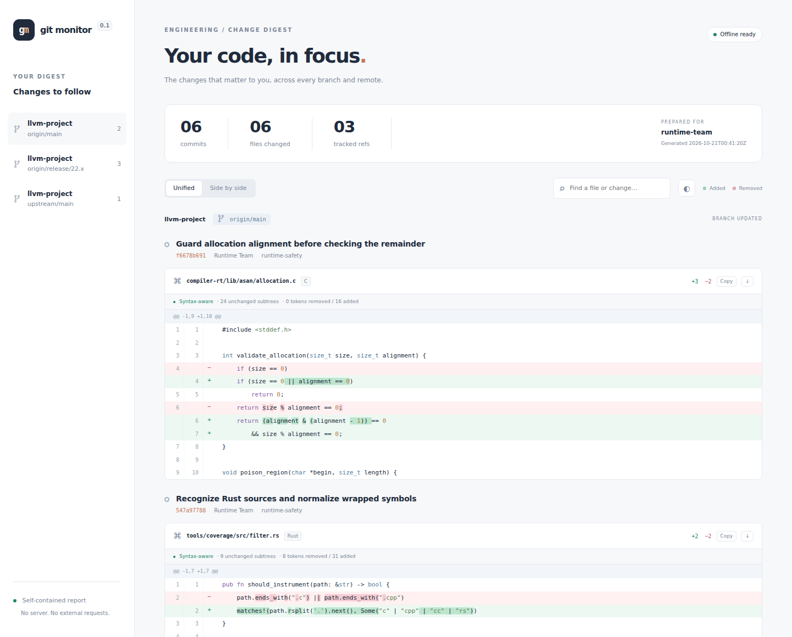
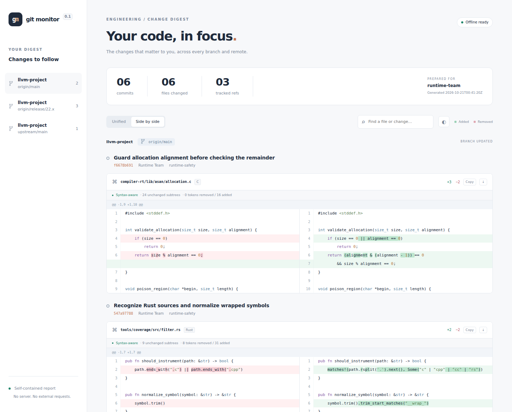

# Git Monitor

Follow the changes you care about across Git repositories, remotes, branches, files, and functions. Receive a personal digest as a self-contained HTML report, with an optional durable SMTP outbox.

Rust · SQLite · system Git · native textual and syntax-aware diff · no web server

## What the report looks like

These screenshots are generated by `git-monitor` from the local demo histories using the actual monitoring pipeline.





[Download the complete example report](docs/example-report.html) and open it in your browser. The attachment includes its CSS, JavaScript, and source data; it makes no external requests. Its unified view also works with JavaScript disabled.

## Build and try it

Requires **Rust 1.90+**, a C compiler, and **Git 2.51+**. The initial supported runtime is Linux/Unix. SQLite and the C/C++/Rust/Python/JSON grammars are built into the binary. Delta, difftastic, Node.js, and Python are not runtime dependencies.

```sh
cargo build --release --locked
./target/release/git-monitor --version
```

Generate the example using only temporary local repositories:

```sh
python3 scripts/demo.py --binary target/release/git-monitor
# Open docs/example-report.html in a browser.
```

The demo establishes a baseline, makes real commits, updates two remotes and a release branch, and runs the monitoring pipeline again. It never contacts an external Git or SMTP server.

## Monitor a repository

Copy [examples/monitor.toml](examples/monitor.toml), then edit repository URLs, recipient IDs, and watches. Relative storage paths resolve against the configuration file's directory.

```sh
git-monitor --config examples/monitor.toml check-config
git-monitor --config examples/monitor.toml doctor

# First successful fetch establishes a baseline; existing history is not mailed.
git-monitor --config examples/monitor.toml run --once

# Run again after a change, or leave the polling process running.
git-monitor --config examples/monitor.toml run
```

Without `--mail-config`, runs fetch and analyze changes and write local HTML reports; **no email is sent**. Each recipient gets `state_dir/artifacts/RECIPIENT-latest.html`. Offline views show recent history within `max_job_output_bytes`; pending email digests take the oldest ready items first and retain deferred items for the next digest. A no-change run keeps the last available report useful for viewing.

```sh
git-monitor --config examples/monitor.toml status
git-monitor --config examples/monitor.toml preview \
  --recipient developer --output ./report.html
git-monitor --config examples/monitor.toml run --once --force \
  --output-dir ./reports
```

`--force` bypasses polling deadlines for that pass. Normal polling respects each remote's interval; failures use bounded exponential backoff. A failed source does not roll back successful sources. `run --once` reports fetch failures through its exit status.

### Example watch

```toml
[[watches]]
id = "asan-changes"
repository = "llvm"
remotes = ["origin", "upstream"]
recipients = ["developer"]
branches = { include = ["main", "release/**"] }
paths = ["compiler-rt/lib/asan/**"]
exclude_paths = ["**/test/**"]
```

Use `branches = { all = true }` for every branch. `*` does not cross `/`; `**` does. Paths are case-sensitive and relative to the Git tree root. One watch can specify paths, a single function, or neither for all content.

Each remote's fetch plan combines its active watches. An unrestricted all-branch watch uses direct atomic fetch. Otherwise, successful `ls-remote` discovery selects the matching heads, and only missing selected tips are downloaded into temporary refs. The confirmed snapshot and an observation marker are then published in one checked Git transaction. A no-change poll needs discovery but no object download. Shared ancestors of selected branches can still include content from other histories.

Discovery/download races trigger up to three discovery attempts before the normal failure backoff. Failed discovery and unfinished downloads never establish branch absence. Adding branch scopes establishes their baseline; removing a scope does not create a deletion event.

```toml
function = { path = "compiler-rt/lib/asan/asan_thread.cpp", match = "ThreadStart" }
```

Function selection uses Git `-L` semantics, including its first-match behavior. Each parent/commit pair is checked separately. Only the selected ranges enter reports, search, and exports; neighboring functions are excluded. Deletion and restoration in one polling window remain separate changes. Attribute-rule changes are checked even when the source file did not change. This does not calculate the effects of called functions, headers, or macros.

## Optional email delivery

Edit [examples/mail.toml](examples/mail.toml). `password_env` is resolved once at startup. An inline password is also supported, but the file must be owner-only. Use `security = "starttls"` or `"tls"` for a real mail server; `"none"` exists for local SMTP testing.

```sh
export GIT_MONITOR_SMTP_PASSWORD='your-app-password'

# Prepare MIME messages for due digests without connecting to SMTP.
git-monitor --config examples/monitor.toml --mail-config examples/mail.toml \
  run --once --prepare-only

# Normal delivery of due digests, including already prepared messages.
git-monitor --config examples/monitor.toml --mail-config examples/mail.toml \
  run --once

git-monitor --config examples/monitor.toml --mail-config examples/mail.toml \
  retry-deliveries
```

The default digest interval is one hour, starting with the recipient's first run. Set `digest_every = "0s"` to prepare a digest at the end of every pass that has matching changes. No digest is generated when nothing matches.

MIME bytes and Message-ID are persisted before SMTP. Ambiguous attempts retain their exact message for retry with bounded exponential backoff; duplicate delivery is possible because SMTP cannot guarantee exactly-once delivery. Configuration changes are reconciled before sending, so pending messages cannot retain revoked scopes or old addresses. Rebuilding a partly delivered digest can repeat previously delivered content.

## State, shutdown, and limits

- Each logical repository has a managed bare cache; each remote/source epoch has an independent snapshot.
- Persisted fetch attempts are recovered **before another fetch**. The `A → B → crash → A` case retains both observed transitions.
- Selected-branch recovery requires the committed observation marker; temporary download refs alone cannot create events. Temporary refs are removed after publication or recovery.
- Commits are enumerated with `rev-list`; each uses `git show --diff-merges=first-parent`, including conflict-resolution changes.
- Identical selected old/new analyses are cached independently of watch names and recipient addresses. Event bindings remain separate.
- Configuration is read once per process. Apply edits by stopping and restarting. SIGTERM/SIGINT stops new work, drains active work within `shutdown_grace`, and leaves unfinished jobs recoverable. SIGHUP is ignored.
- Worker processes have address-space, execution-time, and output budgets. Oversized objects get explicit diagnostics; they do not become empty successful matches.
- MIME parts are packed by file. A single item that cannot fit is replaced with an explicit `oversized_item` card; its full scoped report remains local. Other changes can still be delivered. Increase limits and use `retry-analysis --job ID` for completed or failed analysis jobs.

```sh
git-monitor --config examples/monitor.toml retry-analysis --job 42
git-monitor --config examples/monitor.toml run --once --force
```

Do not share a managed repository directory between unrelated state directories. Repository locks guard active caches. Object pins are intentionally retained in v0.1; automatic pin/cache retention and maintenance are not implemented yet.

State databases upgrade automatically from schema 1 to 2 when opened by this version. Older binaries reject schema 2, preventing them from misinterpreting unfinished selected-branch attempts.

## Diff engine

The application owns its typed diff model, HTML, CSS, and interaction code. Git supplies canonical file patches; native code handles line pairing, intraline highlighting, original coordinates, basic moved-line annotation, themes, copying, and exact byte exports. Selected function snippets use a bounded native line diff.

`mode = "auto"` additionally parses supported languages with Tree-sitter and compares significant token sequences and identical subtrees. The report shows unchanged subtree counts and changed token counts, and identifies formatting/comment-only changes. Parse errors, unsupported languages, and syntax budgets fall back explicitly to text. `mode = "text"` disables structural analysis; `"syntax"` requests it with the same explicit fallback.

This first structural engine is a foundation, **not full difftastic parity**. A dedicated syntax-tree rearrangement view, richer moved-block matching, and more language grammars remain future work. Text changes and exact source exports are retained regardless of structural results.

## Tests and benchmarks

```sh
cargo fmt --check
cargo clippy --all-targets -- -D warnings
cargo test --all-targets --locked
cargo build --release --locked
cargo bench --bench baseline -- --save-baseline my-run
python3 scripts/record-baseline.py --name my-run
```

Integration tests create local Git repositories and a local SMTP fixture. They cover bootstrap/no-op behavior, multiple remotes, shared analysis, force-push/rollback, crash recovery, branch deletion, function scope, deletion/restoration, attributes, merge resolution, MIME limits, durable SMTP retries, hostile HTML, and bounded SIGTERM shutdown. Selected-branch cases additionally check excluded orphan objects, combined watches, coverage changes, empty observations, discovery/download races, incomplete staging, and atomic publication conflicts.

Criterion includes native text/syntax comparisons and an incremental **fetch → analysis → HTML → MIME** pass using local transport and `--prepare-only`. Fixture creation and the initial baseline fetch are outside that measurement. [benchmarks/baselines](benchmarks/baselines) records initial results and their environment; these are observations from one host, not performance guarantees.

The end-to-end suite measures both all-branch and selected-branch fetch on the same one-branch history. Selected discovery/publication adds fixed work on this small fixture; its purpose is to avoid downloading unrelated tips on larger remotes. Tests verify that behavior separately; these measurements do not claim network transfer savings.

To regenerate screenshots and browser checks:

```sh
npm install --no-save playwright@1.62.1
npx playwright install chromium
node scripts/screenshots.cjs
```

The browser checks side-by-side switching, themes, search, no-JS readability, and absence of external requests. An existing Chromium executable can be supplied through `PLAYWRIGHT_CHROMIUM_EXECUTABLE_PATH`.

## v0.1 boundaries

This is the first executable implementation of [ARCHITECTURE.md](ARCHITECTURE.md), not every planned optimization. Fetch and analysis are currently serialized. `new_branch_mode = "summary"` is supported; comparison against a configured branch base is not. Whole-file patches use Git histogram; isolated function snippets use native Myers diff. Reports use UTF-8 paths; unsupported path encodings fail visibly rather than being silently ignored. Oversized single-line byte-chunk delivery and automatic retention are deferred.

Licensed under [MIT](LICENSE).
